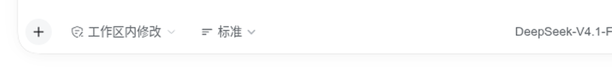
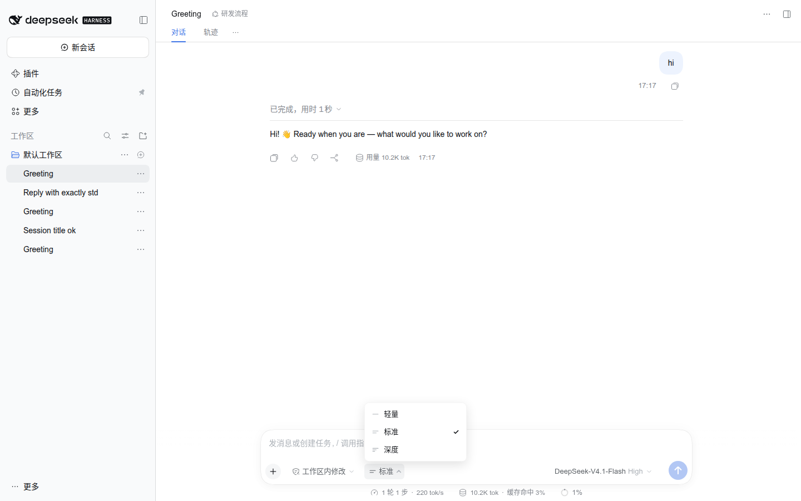

# dsh-rd-workflow

[中文](README.md) | [English](README.en.md)

A **non-default** R&D workflow preset for [DeepSeek Harness](https://github.com/deepseek-ai/deepseek-harness): one preset, three switchable intensity levels, covering Development, Research, and Program orchestration.

- Choose the **研发流程** preset when creating a session.
- Use the always-visible **Intensity** selector in the composer tool row: **Light / Standard / Deep**.
- Switching intensity changes session instructions only. It does **not** swap the preset or its tool set; DSH would refuse a preset swap after the first turn anyway.
- Installing adds the preset and a client-only UI package. It does not change the profile default preset and does not inject the R&D prompt/skills/commands into other presets.

> This README is the complete human-facing document. Agents have one document: [`AGENT.md`](AGENT.md).  
> Release notes and verification records live in [`docs/`](docs/); the E2E packs are Deep-mode reference evidence, not a mandatory formality for every task.

## Contents

- [Quick start](#quick-start)
- [Concepts: intensity and workflows](#concepts-intensity-and-workflows)
- [Development workflow](#development-workflow)
- [Research workflow](#research-workflow)
- [Program orchestration](#program-orchestration)
- [Relationship to DSH Agent Teams](#relationship-to-dsh-agent-teams)
- [Usage](#usage)
- [Documentation structure](#documentation-structure)
- [Links](#links)
- [License](#license)
- [What it does not do](#what-it-does-not-do)
- [Compatibility and limitations](#compatibility-and-limitations)
- [Uninstall](#uninstall)
- [Development and verification](#development-and-verification)

## Quick start

### 1. Install

#### Option A: npm public registry (recommended)

```text
plugin_manager action=install_bundle target=@denniszhangoiler/dsh-rd-workflow@0.9.3
```

CLI equivalent:

```sh
dsh plugin --profile <profile> add @denniszhangoiler/dsh-rd-workflow@0.9.3
```

> **About `npm install`:** the package is on npm, but a DSH plugin is not activated by putting it in a project `node_modules`. To inspect the package:
>
> ```sh
> npm view @denniszhangoiler/dsh-rd-workflow@0.9.3
> npm pack @denniszhangoiler/dsh-rd-workflow@0.9.3
> npm install @denniszhangoiler/dsh-rd-workflow@0.9.3
> ```
>
> The last command only installs the package into the current directory; it does **not** register a DSH plugin. Use `plugin_manager` or `dsh plugin add` for DSH.

#### Option B: GitHub Packages

Configure the scope and a read token; do not commit the token:

```ini
@denniszhangoiler:registry=https://npm.pkg.github.com
//npm.pkg.github.com/:_authToken=${GITHUB_TOKEN}
```

Then use the same target:

```text
plugin_manager action=install_bundle target=@denniszhangoiler/dsh-rd-workflow@0.9.3
```

#### Option C: GitHub Release tarball

Download from [v0.9.3](https://github.com/DennisZhangOiler/dsh-rd-workflow/releases/tag/v0.9.3):

```text
plugin_manager action=install_bundle target=https://github.com/DennisZhangOiler/dsh-rd-workflow/releases/download/v0.9.3/denniszhangoiler-dsh-rd-workflow-0.9.3.tgz
```

#### Option D: Git tag / local checkout

```text
plugin_manager action=install_bundle target=git+https://github.com/DennisZhangOiler/dsh-rd-workflow.git#v0.9.3
```

For local development, use the absolute path to this repository.

A restart may be required; preset updates commonly return `restart-required`.

### 2. Select and verify

1. Create a new session.
2. Choose **研发流程** in the preset roster.
3. The composer shows the **Intensity** selector, default **Standard**.
4. Send a normal task; the agent should not ask you to paste the long workflow prompt.



The menu also works in an existing conversation:



### 3. Switch intensity

- Before the first turn or mid-conversation.
- The next turn uses the new intensity.
- Switching adds only a small `mode` completion row command row; no large user bubble is injected.

## Concepts: intensity and workflows

Two dimensions are intentionally separate:

| Dimension | Values | Decides |
|---|---|---|
| **Intensity** | Light / Standard / Deep | How much ceremony: contract, independent review, UI scoring, E2E, human gate |
| **Workflow** | Development / Research / Program orchestration | What kind of work this is and which pipeline it follows |

### Intensity

Default **Standard**; choose by risk, not habit.

| Intensity | Use for | Contract and review | UI / research | Delivery |
|---|---|---|---|---|
| **Light** | copy/docs, one-file fix, diagnostic, small reversible change | short AC/check in chat; no independent reviewer | screenshot yourself when visual; one spike + internal unreviewed research note | run relevant tests/checks and state what was skipped |
| **Standard** | normal feature, bugfix, refactor, UI behavior, research question | contract for non-trivial work; one independent review for medium/high risk, UI design, or a consequential decision | one UI direction; one review for a consequential research decision | implement, test, verify; no full E2E by default |
| **Deep** | high-risk/security/PII/migration/production/scale, large Program, regulated work | full contract + hash + user confirmation; independent plan/results/verifier reviews | multiple directions, per-area floors, independent score, freeze | full evidence pack, E2E/calibration, human gates |

**Never optional:** safety, secrets, protected branches, explicit confirmation for destructive/remote operations, and human approval for high-risk production work. No intensity skips these.

### Workflows

| Workflow | Use for | Typical outcome |
|---|---|---|
| **Development** | features, bugfixes, refactors, UI behavior, delivery | contract, implementation, tests, independent verification |
| **Research** | technology choices, feasibility, performance/cost validation, codebase research | decision frame, spikes, evidence, reviewed conclusion/handoff |
| **Program orchestration** | multi-module systems, cross-module interfaces, large Programs | architecture/interfaces first, UI freeze, vertical modules, integration verification |

On every message the agent routes the request as question, development, research, or program. If the objective changes, it says so and re-enters the right workflow instead of continuing the previous bugfix loop.

## Development workflow

Higher intensity means more complete execution; Light/Standard use proportional checks.

| Phase | What happens |
|---|---|
| 1. Read the project | `AGENTS.md`, `README.md`, `docs/DEV_WORKFLOW.md`, `docs/DELIVERY.md`, UI/research docs; find commands, layout, conventions |
| 2. Contract | AC-1..n, DoD, NFR, risk tier, data/UI, AC→test→evidence; triage UI as design / behavior / No UI |
| 3. Confirm scope | ask only material questions; confirm goals/acceptance/risk, not a mere recommendation |
| 4. Implement | one feature agent owns the change; separate test authors/reviewers when needed, with disjoint scopes |
| 5. Test | normal, negative, permission, boundary, state; run test/lint/typecheck/build |
| 6. Independent verification | one review for medium/high risk/UI/decisions; Deep uses a verifier checking every AC and evidence item |
| 7. Preview and delivery | give a reproducible preview/acceptance path; follow project delivery rules; do not assume MR/CI/deploy |

**UI work:** follow project UI policy. Standard usually uses one direction; Deep requires independent scoring, per-area floors, total >=85, and no P0/P1. A score is a gate, not a number to optimize.

## Research workflow

The output is a **reviewable decision**, not a persuasive essay.

| Phase | What happens |
|---|---|
| R0 decision frame | decision, baseline, metrics, constraints, timebox, output |
| R1 directions | several directions, including do-nothing; user selects |
| R2 plan | baseline/candidate, workload, MDE/CI/noise, runs, thresholds, stop conditions, representative slice |
| R3 spikes | sandbox `research/<topic>/spikes`; same conditions, semantic parity, keep failures |
| R4 evidence | correctness, performance, variance, cost, failure modes; observation vs inference |
| R5 independent review | extract claims from raw data; supported/partial/unsupported; rerun when needed |
| R6 conclusion | only reviewed claims; label measured-here/sandbox/reported; list what cannot be concluded |
| R7 handoff | development/program input; sandbox-only = candidate/pilot; adopt/migrate/security needs a pilot or written risk acceptance + `MIGRATION.md` |

Light research: decision frame + one spike + an internal note, explicitly unreviewed; it cannot justify adopt/migrate.

## Program orchestration

For large, multi-module, parallel or staged work; usually with Deep intensity.

1. **Architecture/IA first:** users, flows, module boundaries, interfaces, data, non-goals, open decisions; confirm.
2. **UI direction and freeze:** choose a direction, build a pure demo, independent score, then freeze. Frozen UI is not redesigned; gaps go to child UI design/scoring.
3. **Split modules:** interfaces, owned paths, shared-file rules, dependencies, acceptance, tests.
4. **Vertical implementation:** module leads follow the same workflow; children may delegate further, with disjoint write scopes.
5. **Contract tests:** provider/consumer, shared files, migrations, permissions, fixtures; isolate ports/DB/environments or serialize explicitly.
6. **Integration verification:** the Program lead is the only user interface; the integration verifier checks cross-module and regression behavior.

Small projects do not need Program to look formal; Standard is usually better.

## Relationship to DSH Agent Teams

**No conflict, no duplication: Team coordinates, this preset defines standards.**

| Dimension | DSH Agent Teams | This preset |
|---|---|---|
| Problem | Who does the work; task assignment and tracking | What steps to follow; what counts as done |
| Provides | shared task board, ownership/dependencies/write scopes, member messaging | Light/Standard/Deep, contracts/AC/DoD, independent review, UI/research/Program gates, evidence |
| Creates a team | No; reuses the standard subagent tree | No; reuses `subagent`/`workflow` |
| Replaces acceptance | No; task completion is not acceptance | Yes; provides the quality gates and reviewer independence |

**Recommended default:**

- **Light/Standard: keep Team off.** Single-threaded work plus the preset's proportional checks is more controllable.
- **Deep, Program, multi-module parallel work, parallel research/audit: enable Team.**
- Enable only when the work can be split into at least three tasks with clear interfaces and largely disjoint write scopes.
- When enabled, the Team task board is the single source of truth for work items; the preset's contract references task IDs, and write scopes map to `write_scopes`. Do not create a second checklist.
- A Team member is not automatically an independent reviewer; independent review still needs fresh context or a different model.
- `complete` means the work item is done, not that tests, UI scoring, or user acceptance passed.

## Usage

- Composer tool-row **Intensity** selector: before or during the conversation; the selection updates the session instructions.
- A genuinely different tool set still requires a new session/preset; intensity does not swap tools.
- Recommended project docs:
  - `AGENTS.md` — project agent conventions
  - `docs/DEV_WORKFLOW.md` — development/review/test policy
  - `docs/DELIVERY.md` — delivery, migration, rollback, release
  - `docs/UI.md` — UI design/scoring/acceptance
  - `docs/RESEARCH.md` — research evidence and review rules
- When these are missing, the agent infers, asks once, and records the convention; later sessions follow it.

## Documentation structure

Two audiences only:

| Audience | Document | Language |
|---|---|---|
| **Humans** | [`README.md`](README.md) / [`README.en.md`](README.en.md) | Chinese / English |
| **Agents** | [`AGENT.md`](AGENT.md) | one English operating document |

Maintainer/release/history docs (not user entry points):

- [`CHANGELOG.md`](CHANGELOG.md) — changelog
- [`docs/PUBLISHING.md`](docs/PUBLISHING.md) — npm / GitHub Packages publishing and verification
- [`docs/VERIFICATION.md`](docs/VERIFICATION.md) — historical 0.8.0 verification snapshot
- [`docs/TEST-PLAN.md`](docs/TEST-PLAN.md) — historical test plan (terminology updated)
- [`docs/QUALITY-GATE.md`](docs/QUALITY-GATE.md), [`docs/project-conventions.md`](docs/project-conventions.md) — quality-gate and project-convention templates
- [`docs/DETAIL.md`](docs/DETAIL.md) / [`docs/DETAIL.zh.md`](docs/DETAIL.zh.md) — English/Chinese plugin detail
- [`docs/RELEASE-0.9.3.md`](docs/RELEASE-0.9.3.md) — current documentation release
- [`docs/RELEASE-0.9.2.md`](docs/RELEASE-0.9.2.md), [`docs/RELEASE-0.9.1.md`](docs/RELEASE-0.9.1.md), [`docs/RELEASE-0.9.0.md`](docs/RELEASE-0.9.0.md), [`docs/RELEASE-0.8.0.md`](docs/RELEASE-0.8.0.md) — historical release notes
- [`docs/e2e/`](docs/e2e/) — historical E2E evidence, Deep reference packs

## What it does not do

- It is not a new model, tool, or task board; it does not create a team runtime.
- It does not automatically upgrade ordinary work to Deep; intensity follows scope and risk.
- It does not replace human code review, security review, or release ownership.
- It does not require full E2E/calibration for every task; those are Deep reference practices.
- It does not install project dependencies, provide credentials, or bypass DSH permissions/approvals.

## Compatibility and limitations

- DSH `>=0.2.2-rc.5 <0.3.0`.
- Node.js 22+.
- Only profiles that load the Web preset registry (the official Web profile); headless/SDK/ACP do not load it.
- One preset, default Standard; intensity is prompt-level and does not swap tools.
- A different tool composition requires a new session/preset.
- A bare npm install does not register the DSH plugin; use `plugin_manager` or `dsh plugin add`.
- On mount the chip syncs its mode to the Host once, which may add one light command row; a second stateless client can sync its own initial mode.
- No credentials, network service, or database is added.

## Uninstall

```text
plugin_manager action=remove_bundle target=@denniszhangoiler/dsh-rd-workflow
```

Or:

```sh
dsh plugin --profile <profile> remove @denniszhangoiler/dsh-rd-workflow
```

The client package is a dependency and is removed with the main package; session history is preserved.

## Development and verification

```sh
npm test
npm run check
DSH_BIN=<dsh-bin> npm run test:smoke
```

- `npm test`: unit tests + E2E gate
- `npm run check`: package contents and patch checks
- `npm run test:smoke`: disposable-profile install/remove

Publishing: [`docs/PUBLISHING.md`](docs/PUBLISHING.md).

## Links

- [GitHub Releases](https://github.com/DennisZhangOiler/dsh-rd-workflow/releases)
- [npm package](https://www.npmjs.com/package/@denniszhangoiler/dsh-rd-workflow)
- [DeepSeek Harness](https://github.com/deepseek-ai/deepseek-harness)
- [Agent Teams package](https://github.com/deepseek-ai/deepseek-harness/tree/main/packages/team/agent-team)
- [License](LICENSE)

## License

MIT
