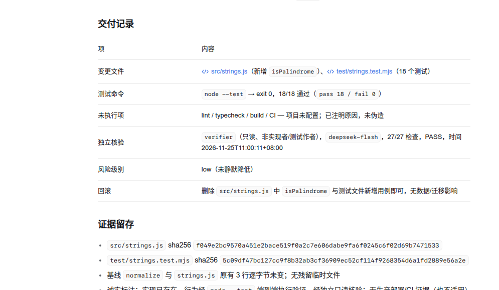
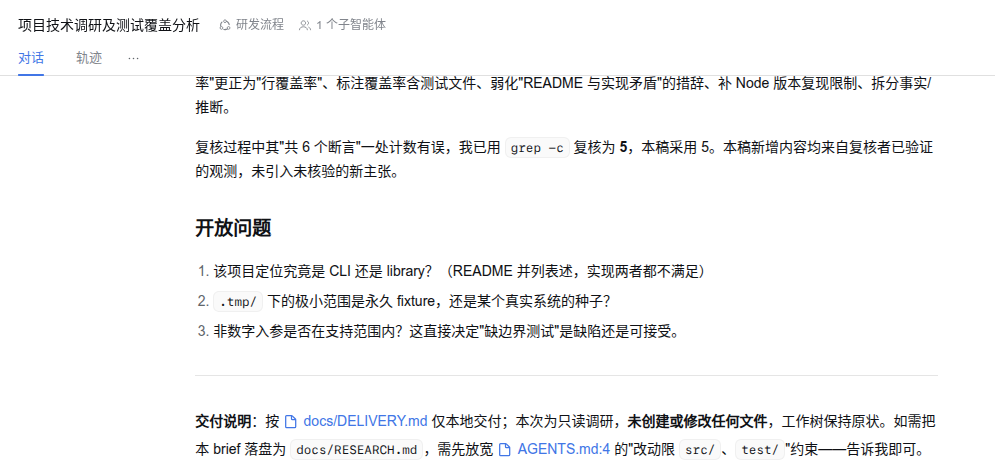

# dsh-rd-workflow

[中文](README.md) | [English](README.en.md)

一个**非默认**的 [DeepSeek Harness](https://github.com/deepseek-ai/deepseek-harness)
智能体预设。在新会话的原生预设菜单里选择 **研发流程**，默认是 **标准**；输入框左侧常驻
**流程强度** 下拉（轻量 / 标准 / 深度），开始对话前和对话中都能调整。它发送的是
会话级模式指令，**不换 preset、不换工具集**；第一轮后 DSH 本来也不允许换 preset。
Agent 会路由到技术调研、开发或大型项目编排流程，不需要每次粘贴长 Prompt。

安装这个 bundle 会新增预设和一个仅客户端的 UI 包（composer 控件）：**不会**修改
profile 的默认预设，不会注册 Host 级的 prompt/skill/command，也不会影响使用
Standard 或其他预设的会话。


## 目录

- [快速开始](#快速开始)
- [三档模式](#三档模式轻量--标准--深度)
- [它做什么](#它做什么)
- [开发流程](#开发流程deep-playbook)
- [与 DSH 智能体团队协作的关系](#与-dsh-智能体团队协作的关系)
- [安装](#安装)
- [使用](#使用)
- [文档导航](#文档导航)
- [要求与兼容性](#要求与兼容性)
- [卸载](#卸载)

## 快速开始

1. 按[安装](#安装)一节安装 bundle，重启 DSH。
2. 新建会话，在预设菜单选择 **研发流程**。
3. 输入框左侧的 **流程强度** 选择器默认是 **标准**；开始对话前或对话中都可以切换轻量/标准/深度。

## 三档模式：轻量 / 标准 / 深度

按风险选流程，不要按习惯选。默认 **Standard**；Agent 只在无法判断时问一次，随时可以切换。

| 模式 | 适合 | 得到什么 |
|---|---|---|
| **轻量**（Light） | 文案/文档、单文件修复、诊断、小而可逆改动 | 简短计划/检查、测试或自检、结果说明；不写契约文件，不派 reviewer，不做完整 E2E |
| **标准**（Standard，默认） | 普通功能/bugfix/重构、UI 改动、调研问题 | 非平凡工作写契约、实现/测试；中高风险、UI design 或关键决策时派一次独立 review |
| **深度**（Deep） | 高风险/安全/迁移/生产/规模化、大型 Program | 完整契约、独立 plan/results/verifier review、UI/调研评分、E2E/校准、人类 gate |

下面整套长流程是 **Deep** 的完整 playbook；Standard 按比例使用；Light 只保留 brief、改动和检查。详见 [`docs/MODES.md`](docs/MODES.md)。

## 它做什么

第一条规则是 **每轮请求路由**：把当前消息分为问答、bugfix/微调、新功能/重构、调研或
Program。目标变了就明确说出来，重新进入契约或调研 brief，而不是继续上一轮 bugfix。


## 开发流程（Deep playbook）

Deep 使用下面完整阶段；Standard 按比例使用；Light 跳过契约/评分/E2E 形式。流程规则写在 system prompt section 中，因此不依赖聊天历史，也不会在上下文压缩后
丢失。预设会追加 `Mode:` 段，prompt 据此使用对应强度的检查。

| 阶段 | 结果 |
|---|---|
| 0. 项目理解 | 按顺序读 `AGENTS.md`、`docs/DEV_WORKFLOW.md`、`docs/DELIVERY.md`、`README.md` 及其他文档；确认命令、交付方式、目录结构和 UI 界面所在位置 |
| 1. 契约与分级 | 写验收契约：AC/DoD/NFR、风险等级、数据/UI、追踪矩阵；分为 **UI design**、**UI behavior** 或 **No UI**；材料性问题一次问清 |
| 2. UI 方向探索 | **仅 UI design：**按项目策略决定方向数（小改动可 1 个，大改动问一次），每个方向有真实桌面/移动截图 |
| 3. 独立 UI 评分 | **仅 UI design：**独立 scorer 对每个方向（含 1 个）评分；门禁为**每领域 floor + 总分 >=85 + 无 P0/P1**，并检查真实移动端/键盘/a11y |
| 4. 用户确认 | AC/DoD/NFR + 方向/截图/改动清单；UI behavior 给变化状态；No UI 给功能清单；明确 yes |
| 5. 开发 | 同一功能智能体负责改动；有 UI 时同时负责 UI 和功能；测试智能体只写测试 |
| 6. 独立测试 | 逐条测 AC；按分级测功能/CLI/API、UI 状态或 UI design；真实 API/mutation、marker/清理；test/lint/typecheck/build |
| 7. 独立验收 | 只读 verifier 检查每条 AC+证据、diff、命令、数据/边界/残留、最终 UI 分；记录 reviewer 身份/hash/verdict |
| 8. 用户预览验收 | 给出预览方式/测试数据/验收清单；No UI 可用命令、样例请求或输出样例；内部 PASS 不等于用户验收 |
| 9. 交付 | 按文档执行；migration `MIGRATION.md` 演练/回滚；post-deploy smoke/监控；不假设 MR/PR/CI/部署 |

### 契约、风险和证据

实现前先写验收契约（`AC-1..n`、Definition of Done、适用 NFR、风险等级、数据/UI/migration、AC→test→evidence 矩阵）。用户确认的是 AC/DoD/NFR，不只是方向。高风险还要威胁模型、SCA/license、SAST、migration 演练、回滚/发布后计划和人类代码/发布审批。详见 `rd-workflow-contract` 和 `rd-workflow-delivery`。




证据必须区分 **implemented**、**statically tested**、**exercised end-to-end**、**observed in production**；unit test 不是生产证明，计划截图不是执行证据，内部 PASS 不是用户验收。高风险变更不能替代人类 code review、安全评审和发布责任。

### 技术调研模式

非平凡的技术/代码库调研、架构或依赖对比、可行性分析、根因分析走
**实验优先**的调研流程。文章、官方文档和上游 benchmark 只用来产生假设；最终证据必须
来自在本项目或代表性 sandbox 中的实测。

| 阶段 | 结果 |
|---|---|
| R0 上下文 | 读文档/代码；确定决策、当前 baseline、指标、约束、时间盒和输出位置 |
| R1 方向 | 提出**尽量多的真正不同方向**（不固定 2-3 个），用户选择要跑哪些；确认前不搭建 |
| R2 计划 + 计划评审 | baseline/候选、MDE/CI/noise、运行/方差、slice/排除项、阈值/停止/保留物；**独立评审用每领域 floor + 总分 >=80 + 无 P0/P1 + 最多 3 个未解决 P2**后才允许 demo |
| R3 小 demo | 在 sandbox 中做小 demo 与 baseline 同条件对比；检查语义一致性，记录命令/版本/数据；失败也保留；不改生产代码 |
| R4 测量 | 正确性、性能与方差、成本、失败模式；观察和解释分开；不挑数据 |
| R5 结果评审 | 全新 reviewer 从 raw data 独立提取 claim，审核过程/数据/baseline，标 supported/partial/unsupported + 准确措辞；partial 不能支持 adopt/migrate；冻结 memo hash |
| R6 决策 | 只包含已评审结论的备忘录，标 `measured-here` / `measured-sandbox` / `reported`；被否方向、置信度、开放问题、不能得出什么 |
| R7 交接 | 开发/Program 输入；sandbox-only=candidate；adopt/migrate/security 需 pilot 或书面风险接受 + `MIGRATION.md`；调研不做生产迁移 |

**没有单独的迁移验证阶段**。实验必须使用代表性项目切片或副本，在测量过程中就验证
适配性；真要迁移，走正常开发流程。

标准强度 = 用户选定方向、通过实验计划评审、每个可行方向至少一个实测 demo、结果评审。
深度调研会增加 demo/运行次数、矩阵和敏感性分析。

评审意见必须明确：严重级别、位置、证据、为什么影响结论、要求的动作、通过条件。
没有 finding 的分数、“建议优化”“看起来不错”这类反馈都算无效评审。只有通过评审的
结论才能给用户看。

这一版覆盖技术/代码库调研；外部市场调研和用户调研不在范围内。



### 大型项目：Program mode

新建系统、多模块产品，或架构/信息架构重构时，主 Agent 变成全局编排者，而不是自己
把所有事做完：

1. **架构优先。** 梳理用户、核心流程、模块、边界、接口、数据归属、非目标和待定
   决策；先不要写模块代码，架构确认后再继续。
2. **UI 方向选择。** 按项目文档的 UI 规则；文档规定了几版就出几版；没有规定且是
   大改动时，先问一次要几版（建议三版），等用户选择，不能自己确认。
3. **静态前端 demo。** 用 mock 数据做纯前端 demo，按用户反馈迭代；冻结前做**独立评分**，然后冻结 token、组件、页面、状态和响应式规则。
4. **模块计划。** 拆成完整的垂直模块，写清接口、拥有路径、共享文件规则、依赖、验收标准和 provider/consumer 契约测试；隔离端口/DB/fixture/env。
5. **模块 Agent。** 用 `subagent` 派模块负责人；每个模块负责人按本插件的流程执行。
   已冻结的 UI 不再重做；遗漏的重要 UI 细节由子智能体重新走 UI 设计/评分流程。
   模块负责人还可以派自己的 UI、功能、测试和验收子智能体（根节点下最多 3 层）。
6. **集成。** 只读集成 verifier 运行跨模块契约测试，检查共享文件、migration、权限、夹具残留和运行时资源冲突；然后用户预览，按文档交付。

Program lead 是唯一对用户说话的入口；模块负责人把证据汇总回来。共享文件有唯一
owner，串行修改；独立模块可以并行。完整规则见 `rd-workflow-program` skill。

### 约定学一次，后面照着做

Agent 会先读项目里的约定文档。如果缺少它需要的规则（UI 方向数量、静态 demo、
交付方式、测试命令等），它会先从代码和需求推断，然后**一次性**问清需要用户决定
的缺口（带推荐默认值），再把答案写进项目文档：优先更新已有文件，没有就写
`docs/DEV_WORKFLOW.md`、`docs/UI.md`、`docs/DELIVERY.md` 或 `docs/RESEARCH.md`。
后续会话读文档，不再重复问。

所以你不需要每次都说“给我出三版 UI”或“本地交付”。说一次（或者让 Agent 问一次），
规则就沉淀到项目里了。

### UI 影响按每次改动判断

Phase 1 判断的是这次改动，而不是项目类型：

- **UI design**：新增或明显改变信息层级、布局、交互模式或 UI 界面。走 Phase 2-3
  和独立 UI 评分。
- **UI behavior**：用户可见的行为、文案或状态变化，但没有新的设计方向。跳过
  Phase 2-3；保留 UI 功能检查和预览，但不做设计评分。
- **No UI**：库、CLI、后端、基础设施、数据、构建或文档改动。跳过所有 UI 阶段
  和 UI 评分；测试只覆盖功能/CLI/API。

今天的纯 CLI 项目，在“新增 GUI”这次改动里可以判为 **UI design**；已有 UI 的项目，
后端-only 改动也可以判为 **No UI**。分级会写进 Phase 1 契约，出现新界面时可以
重新分级。

项目文档按自然语言处理。如果项目没有写交付方式，改动默认只保留在本地，并且
只问用户一次希望如何交付。凭据不会写入项目文档。远程或破坏性操作执行前必须
获得用户确认。

## 与 DSH 智能体团队协作的关系

**不冲突，也不重复。** Agent Teams 是平台层的**协作机制**，研发流程是**过程与验收策略**：

| 维度 | DSH Agent Teams | 研发流程插件 |
|---|---|---|
| 解决什么 | 谁来做、任务如何分配和跟踪 | 按什么步骤做、什么算完成 |
| 提供什么 | 子代理树共享任务板、任务归属/依赖/写范围、成员消息 | Light/Standard/Deep、契约/AC/DoD、UI 分级、独立 review、调研/Program、证据 |
| 是否创建 Agent | 使用标准 subagent，不另造成员体系 | 使用 `subagent`/`workflow` 派活，不创建团队运行时 |
| 是否替代质量门 | 不替代；任务完成 ≠ 验收 | 提供质量门和 reviewer 独立性 |

同时开启时：

- 让 **Team 任务板**做工作项、所有权和依赖的唯一来源；研发流程的契约引用任务 ID，写范围映射到 `write_scopes`。
- Program / 多模块工作适合 Team；Light/Standard 的小任务没必要额外开 Team。
- Team 成员仍不等于“独立 reviewer”；独立评审要求新上下文/不同模型，不能自己批准自己。
- 不要在插件里再建一套任务板或重复清单；任务完成也不等于 UI/测试/验收通过。

**默认建议：Light/Standard 不开 Team；Deep Program、多模块并行、并行调研/审计再开。** 详细说明见 [`docs/AGENT-TEAMS.md`](docs/AGENT-TEAMS.md)。

## 安装

### 从 GitHub 安装

版本说明：[`docs/RELEASE-0.9.1.md`](docs/RELEASE-0.9.1.md)。

0.9.1 已以 scoped 包名发布到 npm 公共 registry 和 GitHub Packages。npm 安装：

```text
plugin_manager action=install_bundle target=@denniszhangoiler/dsh-rd-workflow@0.9.1
```

如果 npm 名称仍在传播，改用下面的 GitHub Packages 或 release tarball。GitHub Packages
需要先配置 scope 和认证（不要把 token 提交到仓库）：

```ini
@denniszhangoiler:registry=https://npm.pkg.github.com
//npm.pkg.github.com/:_authToken=${GITHUB_TOKEN}
```

然后使用同样的 target。旧 0.8.0 GitHub Release tarball 仍然保留；0.9.1 是新的
scoped 包，切换时需要重新安装。`dev-workflow` preset id 不变。

安装后新建会话，打开预设菜单，选择 **研发流程**。安装会新增预设和仅客户端 UI 包；
不会修改默认预设，也不影响其他 preset。preset 更新可能返回 `restart-required`。

### 安装前备份

先备份 profile，保证可回滚：

```sh
PROFILE_DIR="$DSH_HOME/profiles/<profile>"
cp -a "$PROFILE_DIR" "$PROFILE_DIR.backup-$(date +%Y%m%d-%H%M%S)"
```

### 通过 DSH Web UI

1. 打开 **Plugins**。
2. 选择 **Add plugin** 并选中本地 `dsh-rd-workflow` checkout；GitHub 源请用上面的
   `plugin_manager` 命令安装。
3. 保持 bundle 启用。它只新增预设，不会自动选中。
4. 新建会话，打开预设菜单，选择 **研发流程**。

### 通过 `plugin_manager` 工具

```text
plugin_manager action=install_bundle target=/绝对路径/dsh-rd-workflow
# 或已打包的 release tarball：
plugin_manager action=install_bundle target=/绝对路径/dsh-rd-workflow-0.8.0.tgz
```

target 是包含 `package.json` 和 `cordis.patch.yml` 的 bundle 目录，或打包好的
release tarball。安装会执行包管理和 bundle 选择，不需要手工改 profile。安装
bundle 代码需要 Full access 或审批。preset 变更可能会返回
`restart-required`；重启一次 DSH，再新建会话。

### 命令行替代方式

如果从终端管理 profile，CLI 使用同样的包选择和 patch 校验，重启后生效：

```sh
# GitHub 源
dsh plugin --profile <profile> add git+https://github.com/DennisZhangOiler/dsh-rd-workflow.git
# 或本地 checkout
dsh plugin --profile <profile> add /绝对路径/dsh-rd-workflow
# 重启后按下面步骤验证；卸载：
dsh plugin --profile <profile> remove dsh-rd-workflow
```

### 验证预设

```sh
dsh --profile <profile> --dump-config | grep -A3 preset-dev-workflow
dsh --profile <profile> --dump-config | grep -A2 agent-preset-registry
```

第二条应仍显示原来的默认值（例如 `default: standard`）。新会话的预设列表中
应能看到 **研发流程**（R&D Workflow）。

## 使用

选择该预设后直接描述需求：

```text
设置页还是旧表格。改成可筛选的卡片列表，沿用现有设计系统，移动端也要能用。
```

之后由预设的契约 section 驱动完整流程。也可以按名称加载配套 skill：
`rd-workflow`、`rd-workflow-project-docs`、`rd-workflow-ui-rubric`、
`rd-workflow-roles`。

### 建议的项目文档

没有这些文档也能用，但有的话效果更好：

- `AGENTS.md`：命令、边界、允许修改的路径、风格规则。
- `docs/DEV_WORKFLOW.md`：开发、评审、测试流程。
- `docs/DELIVERY.md`：改动如何到达用户（分支、MR/PR、CI、部署、手动发布、
  仅补丁）。
- `README.md`：安装和常用命令。

示例见 `rd-workflow-project-docs` skill 和
[`docs/project-conventions.md`](docs/project-conventions.md)。示例不是固定
字段 schema。

## 参考证据（Deep 模式）

`docs/e2e/0.8/` 是 **Deep 模式的参考证据**，不是每个任务都必须走的形式：

- No-UI fixture：contract hash、AC1–AC7、8/8 测试、独立 verifier 89 PASS。
- UI design：A · Ledger readiness dashboard，独立评分 91 PASS。
- Program：两模块 contract/isolation E2E，独立评审 86 narrow PASS。
- 高风险：0.7→0.8 配置迁移 rehearsal，7/7 测试、rollback 字节一致；人类只批准
  rehearsal，真实 apply 仍 blocked。
- 调研：plan review REVISE→PASS、results review PASS、memo review PASS，
  reduced-scope 校准。

这些分数**不是**统一的发布门禁。Light/Standard 使用
[`docs/MODES.md`](docs/MODES.md) 里的按比例检查。0.8.0 预设和客户端 UI 已发布到
GitHub；npm 包未发布。

## 文档导航

- [文档索引](docs/README.md)
- [三档模式说明](docs/MODES.md)
- [与 Agent Teams 的关系](docs/AGENT-TEAMS.md)
- [发布与 registry 指南](docs/PUBLISHING.md)
- [0.9.1 版本说明](docs/RELEASE-0.9.1.md)
- [验证记录](docs/VERIFICATION.md)
- [变更日志](CHANGELOG.md)

历史 E2E 证据包在 `docs/e2e/`，属于 Deep 模式的参考证据，不是每个任务的必经流程。

## 要求与兼容性

- DSH `>=0.2.2-rc.5 <0.3.0`（见 `engines.dsh`）。
- Node.js 22 或更高（DSH 要求）。
- profile 需要提供该预设挂载的 Host 服务：system prompt、skills、tools、
  plan mode、subagent、workflow。官方 Web profile 满足；headless/SDK/ACP
  profile 不加载 Web preset registry，不支持此 bundle。
- 本插件不新增凭据、网络服务或数据库。

## 它不做什么

- 不会把 **研发流程** 设为默认预设。
- DSH 0.2.2-rc.5 的 `presetDisplayText` 只翻译内置 preset；自定义 preset 的名称/描述是静态字符串。本 bundle 的菜单文案使用中文（**研发流程**）以匹配 zh-CN 系统；bundle 卡片和详情页通过 `locale/*.json` 本地化。若要英文菜单，请在安装前替换 `cordis.patch.yml` 中的这两个字符串；仅切换 DSH 界面语言不会重新翻译它们。
- 不做 sandbox 级的角色隔离；角色/写作用域由 prompt 和父 Agent 检查保证。高风险仍需人类 code/安全/发布 review。
- 它是 human-in-the-loop 的流程脚手架，不是自治的生产控制系统；不能证明 reviewer 无偏见、截图真实或部署已发生（除非有观测证据）。
- 不安装项目 skill、设计系统、浏览器或测试框架；使用项目和会话已有的能力。
- 不承诺插件市场中心化上架。当前索引格式见
  [`docs/PUBLISHING.md`](docs/PUBLISHING.md)。

## 开发

```sh
npm test          # 插件、prompt、skill 契约测试
npm run check     # 包清单、locale、详情页、patch 检查
npm run test:smoke # 临时 profile：装 tarball、检查预设、卸载
```

`test:smoke` 需要 `dsh` 和 `pnpm` 在 `PATH` 中；CLI 不在 PATH 时设置 `DSH_BIN`。
它会创建临时 `DSH_HOME`，不使用凭据，结束后自动清理。

这些检查不需要安装依赖，Node 22 即可。`npm run check` 在环境有
`python3` + PyYAML 时会校验 YAML，否则会说明跳过。

```text
index.js                 Host 侧预设插件：注册 prompt section + skills
prompt.md                system prompt section 源文
cordis.patch.yml         @deepseek-ai/dsh-agent-preset 声明
skills/                  通过 skill 工具按需加载的 playbook
locale/en.json|zh.json   bundle 卡片元数据
docs/DETAIL*.md          bundle 详情文档（一张预览图）
docs/preview.svg         详情页配图
icon.svg                 插件图标
test/                    单元、打包与临时 profile smoke 测试
```

## 卸载

在 **Plugins** 中移除 **dsh-rd-workflow** bundle，或：

```text
plugin_manager action=remove_bundle target=dsh-rd-workflow
```

移除后预设和 prompt section 一并消失。已经在运行的会话会保留启动时的预设
组合，直到被替换。安装和卸载都不会修改项目文件。

## 许可证

MIT，见 [LICENSE](LICENSE)。
