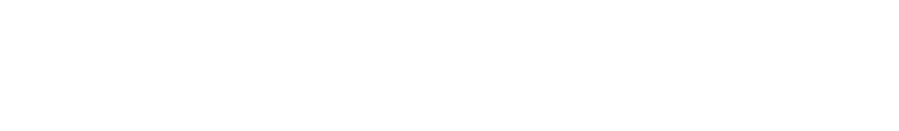
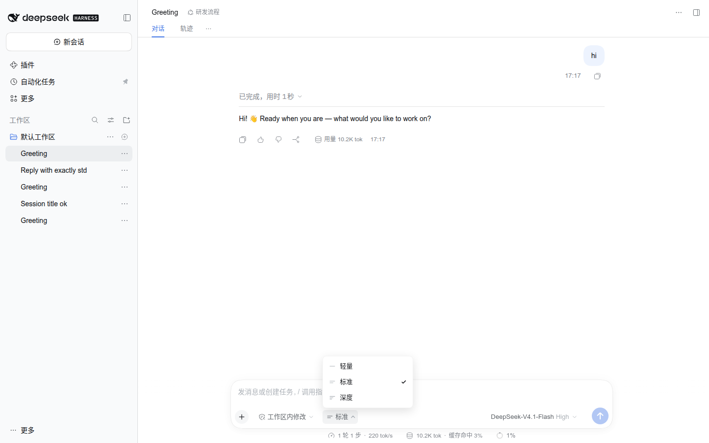

# dsh-rd-workflow

[中文](README.md) | [English](README.en.md)

一个**非默认**的 [DeepSeek Harness](https://github.com/deepseek-ai/deepseek-harness) 研发流程预设：用一个预设、三档可切换的强度，覆盖开发、调研和大型项目编排。

- 新建会话时选择 **研发流程** 预设。
- composer 底部工具行常驻 **强度** 选择器：**轻量 / 标准 / 深度**。
- 强度切换只改变当前会话的流程指令，**不换 preset、不换工具集**；第一轮之后 DSH 本来也不允许换 preset。
- 安装只新增预设和一个仅客户端 UI 包，不会修改 profile 默认预设，也不会把研发流程的 prompt/skill/command 注入其他 preset。

> 这份 README 是给人读的完整文档。给 agent 读的只有一份：[`AGENT.md`](AGENT.md)。  
> 历史发布说明和验证记录在 [`docs/`](docs/)；E2E 证据包是 Deep 强度下的参考样例，不是每个任务的必经流程。

## 目录

- [快速开始](#快速开始)
- [概念：强度模式与工作流程](#概念强度模式与工作流程)
- [开发流程](#开发流程)
- [调研流程](#调研流程)
- [项目编排流程](#项目编排流程)
- [与 DSH 智能体团队（Agent Teams）的关系](#与-dsh-智能体团队agent-teams的关系)
- [使用方式](#使用方式)
- [文档结构](#文档结构)
- [相关链接](#相关链接)
- [License](#license)
- [它不做什么](#它不做什么)
- [兼容性与限制](#兼容性与限制)
- [卸载](#卸载)
- [开发与验证](#开发与验证)

## 快速开始

### 1. 安装

#### 方式 A：npm 公共 registry（推荐）

```text
plugin_manager action=install_bundle target=@denniszhangoiler/dsh-rd-workflow@0.9.2
```

CLI 等价写法：

```sh
dsh plugin --profile <profile> add @denniszhangoiler/dsh-rd-workflow@0.9.2
```

> **关于 `npm install`**：  
> 上面的包确实在 npm 上，但 DSH 插件不是靠把包放进项目 `node_modules` 生效的。  
> 只查看包内容时可以：
>
> ```sh
> npm view @denniszhangoiler/dsh-rd-workflow@0.9.2
> npm pack @denniszhangoiler/dsh-rd-workflow@0.9.2
> npm install @denniszhangoiler/dsh-rd-workflow@0.9.2
> ```
>
> 最后一条只把包装进当前目录，**不会注册到 DSH profile**。安装 DSH 插件请使用 `plugin_manager` 或 `dsh plugin add`。

#### 方式 B：GitHub Packages

GitHub Packages 用于安装的包名相同，但需要先配置 scope 和读取 token：

```ini
# ~/.npmrc 或 profile 使用的 npmrc
@denniszhangoiler:registry=https://npm.pkg.github.com
//npm.pkg.github.com/:_authToken=${GITHUB_TOKEN}
```

然后使用同样的安装命令：

```text
plugin_manager action=install_bundle target=@denniszhangoiler/dsh-rd-workflow@0.9.2
```

GitHub Packages 是公开包，但仍然需要 authenticated read token；不要把 token 提交到仓库。

#### 方式 C：GitHub Release tarball

从 [v0.9.2 Release](https://github.com/DennisZhangOiler/dsh-rd-workflow/releases/tag/v0.9.2) 下载：

```text
plugin_manager action=install_bundle target=https://github.com/DennisZhangOiler/dsh-rd-workflow/releases/download/v0.9.2/denniszhangoiler-dsh-rd-workflow-0.9.2.tgz
```

#### 方式 D：Git tag / 本地 checkout

```text
plugin_manager action=install_bundle target=git+https://github.com/DennisZhangOiler/dsh-rd-workflow.git#v0.9.2
```

本地开发时，把 target 换成本仓库的绝对路径即可。

安装后可能需要重启 DSH；preset 更新通常会返回 `restart-required`。

### 2. 选择预设并验证

1. 新建会话。
2. 在预设菜单选择 **研发流程**。
3. 输入框左侧出现 **强度** 选择器，默认 **标准**。
4. 可以先在输入框里写一句普通任务，确认 agent 没有要求你重复粘贴长流程。



已有对话里也可以展开选择：



### 3. 切换强度

- 开始对话前：直接在 composer 左侧选择。
- 对话中：随时切换；下一条消息开始使用新强度。
- 切换后只产生一条很轻的 `mode` completion row 记录，不会插入大段 user 消息。

## 概念：强度模式与工作流程

插件里有两个容易混淆的维度，先把它们分开：

| 维度 | 取值 | 决定什么 |
|---|---|---|
| **强度模式** | 轻量 / 标准 / 深度 | 流程要做多重：契约、独立评审、UI 评分、E2E、人类 gate |
| **工作流程** | 开发 / 调研 / 项目编排 | 当前任务属于哪类工作，以及走哪条流水线 |

### 强度模式

默认 **标准**；按风险选，不要按习惯选。

| 强度 | 适合 | 契约与评审 | UI / 调研 | 交付 |
|---|---|---|---|---|
| **轻量** | 文案/文档、单文件修复、诊断、小而可逆改动 | 聊天里写简短 AC/检查；无独立 reviewer | 需要时自己截图；调研只做一个 spike + 内部未评审 note | 跑相关测试/检查，说明没跑什么 |
| **标准** | 普通功能、bugfix、重构、UI 改动、调研问题 | 非平凡工作写契约；中高风险/UI design/关键决策做一次独立评审 | UI 一个方向；关键调研做一次评审 | 实现、测试、验收；不默认上完整 E2E |
| **深度** | 高风险/安全/PII/迁移/生产/规模化、大型项目、受监管工作 | 完整契约 + hash + 用户确认；plan/results/verifier 独立评审 | 多方向、每领域 floor、独立评分、冻结 | 完整证据包、E2E/校准、人类 gate |

**不能省的东西：**安全、密钥、受保护分支、破坏性/远程操作的明确确认，以及高风险生产工作的人类批准。任何强度都不能跳过这些。

### 工作流程

| 工作流程 | 适合 | 典型结果 |
|---|---|---|
| **开发流程** | 新功能、bugfix、重构、UI 行为和交付 | 契约、实现、测试、独立验收 |
| **调研流程** | 技术选型、可行性、性能/成本验证、代码库调研 | 决策框架、spike、证据、评审后的结论/交接 |
| **项目编排流程** | 多模块系统、跨模块接口、需要拆分的 Program | 架构/接口先行、UI 冻结、纵向模块、集成验收 |

Agent 会在每条消息上做**路由**：问答、开发、调研或项目编排。目标变了就明确说出来并重新进入对应流程，而不是继续上一轮的 bugfix 循环。

## 开发流程

强度越高，执行越完整；轻量/标准按比例使用，不是每一步都必须产出文件。

| 阶段 | 做什么 |
|---|---|
| 1. 读项目 | 读 `AGENTS.md`、`README.md`、`docs/DEV_WORKFLOW.md`、`docs/DELIVERY.md`、UI/调研文档，找命令、布局和约定 |
| 2. 定契约 | 写 AC-1..n、DoD、NFR、风险等级、数据/UI、AC→test→evidence；UI 分为 design / behavior / No UI |
| 3. 确认范围 | 只问材料性问题；确认目标、验收、风险，不把“建议”当用户选择 |
| 4. 实现 | 一个功能 agent 负责改动；需要时另派测试作者/评审者，写范围不重叠 |
| 5. 测试 | 覆盖正常、负向、权限、边界、状态；跑 test/lint/typecheck/build |
| 6. 独立验收 | 中高风险/UI/关键决策做独立 review；深度由 verifier 检查每条 AC 与证据 |
| 7. 预览与交付 | 给用户可复现的预览/验收方式；交付按项目文档执行，不假设 MR/CI/部署 |

**UI 工作**：按照项目 UI 政策选择方向；Standard 通常一个方向，Deep 需要独立评分、每领域 floor 和总分 >=85、无 P0/P1。评分不是为了凑分，未通过就修。

## 调研流程

调研的产物是**可复核的决策**，不是一篇“看起来很有道理”的文章。

| 阶段 | 做什么 |
|---|---|
| R0 决策框架 | 决策问题、基线、指标、约束、时间盒、输出 |
| R1 方向 | 提出多个方向（数量不设死上限），包含“不做什么”；用户选择 |
| R2 计划 | baseline/candidate、workload、MDE/CI/noise、运行环境、阈值、停止条件、代表切片 |
| R3 spike | 在沙箱 `research/<topic>/spikes` 做实验；同条件、语义等价、保留失败数据 |
| R4 证据 | 正确性、性能、方差、成本、失败模式；区分 observation / inference |
| R5 独立评审 | 从原始数据抽取 claim；标注 supported/partial/unsupported；必要时重跑 |
| R6 结论 | 只写评审允许的结论；标注 measured-here / sandbox / reported；列出不能结论的部分 |
| R7 交接 | 开发/项目编排输入；sandbox 结果只能算 candidate/pilot；adopt/migrate/security 需要 pilot 或书面风险接受 + `MIGRATION.md` |

轻量调研只做决策框架 + 一个 spike + 内部 note，并明确标注“未独立评审”；不能据此直接 adopt/migrate。

## 项目编排流程

用于大型、多模块、需要并行或分阶段交付的工作；通常配合 Deep 强度。

1. **架构与 IA 先行**：用户、流程、模块边界、接口、数据、非目标、开放决策；先确认。
2. **UI 方向与冻结**：选方向、做纯 demo、独立评分通过后冻结；冻结后不回头重设计，缺口走子模块 UI 设计/评分。
3. **拆分模块**：每个模块有接口、owned paths、共享文件规则、依赖、验收、测试。
4. **纵向实现**：模块负责人按同一流程执行；child 可以继续派子 agent，但写范围必须不重叠。
5. **契约测试**：provider/consumer、共享文件、迁移、权限、fixture；端口/DB/环境隔离或明确串行。
6. **集成验收**：Program lead 是唯一用户接口；集成 verifier 做跨模块和回归验收。

小项目不需要为了“看起来正规”强行上 Program；Standard 往往更合适。

## 与 DSH 智能体团队（Agent Teams）的关系

**不冲突，也不重复：Team 管“协作”，研发流程管“标准”。**

| 维度 | DSH Agent Teams | 研发流程插件 |
|---|---|---|
| 解决什么 | 谁来做、任务如何分派和跟踪 | 按什么步骤做、什么算完成 |
| 提供什么 | 子代理树共享任务板、任务归属/依赖/写范围、成员消息 | 轻量/标准/深度、契约/AC/DoD、独立评审、UI/调研/项目编排、证据 |
| 是否创建团队 | 不；复用标准 subagent 树 | 不；复用 `subagent`/`workflow` |
| 是否替代验收 | 不；任务完成不等于验收 | 提供验收门禁和 reviewer 独立性 |

**默认建议：**

- **轻量/标准：默认关闭 Team。** 单线程 + 研发流程的轻量契约/评审更可控。
- **深度、项目编排、多模块并行、并行调研/审计：再开启 Team。**
- 只有当任务能拆成至少 3 个写范围基本不重叠、接口明确的工作项，才值得开启。
- 开启后：Team 任务板是唯一任务来源；插件的契约引用任务 ID，写范围映射到 `write_scopes`，不要再建第二套任务清单。
- Team 成员不等于独立 reviewer；独立评审仍需要新上下文/不同模型。
- 任务 `complete` 只代表工作项完成，不等于测试、UI 评分或用户验收。

## 使用方式

- composer 底部工具行的 **强度** 选择器：开始前/对话中都可切换；选择会同步到当前会话的流程指令。
- 需要真正不同的工具集时，仍然要新会话/换 preset；强度切换不改变工具组合。
- 项目里建议维护：
  - `AGENTS.md`：项目级 agent 约定
  - `docs/DEV_WORKFLOW.md`：开发/评审/测试规则
  - `docs/DELIVERY.md`：交付、迁移、回滚、发布
  - `docs/UI.md`：UI 设计/评分/验收
  - `docs/RESEARCH.md`：调研证据和评审规则
- 没有这些文档时，agent 会先推断并只问一次，然后把约定写下来；后续按文档执行。

## 文档结构

只有两类读者：

| 读者 | 文档 | 语言 |
|---|---|---|
| **人** | [`README.md`](README.md) / [`README.en.md`](README.en.md) | 中文 / English |
| **Agent** | [`AGENT.md`](AGENT.md) | 一份英文操作文档 |

维护/发布/历史文档（不作为用户入口）：

- [`CHANGELOG.md`](CHANGELOG.md)：变更记录
- [`docs/PUBLISHING.md`](docs/PUBLISHING.md)：npm / GitHub Packages 发布与验证
- [`docs/VERIFICATION.md`](docs/VERIFICATION.md)：0.8.0 历史验证快照
- [`docs/TEST-PLAN.md`](docs/TEST-PLAN.md)：历史测试计划（术语已更新）
- [`docs/QUALITY-GATE.md`](docs/QUALITY-GATE.md)、[`docs/project-conventions.md`](docs/project-conventions.md)：质量门与项目约定模板
- [`docs/DETAIL.md`](docs/DETAIL.md) / [`docs/DETAIL.zh.md`](docs/DETAIL.zh.md)：插件详情英文/中文
- [`docs/RELEASE-0.9.2.md`](docs/RELEASE-0.9.2.md)：当前文档版本
- [`docs/RELEASE-0.9.1.md`](docs/RELEASE-0.9.1.md)、[`docs/RELEASE-0.9.0.md`](docs/RELEASE-0.9.0.md)、[`docs/RELEASE-0.8.0.md`](docs/RELEASE-0.8.0.md)：历史发布说明
- [`docs/e2e/`](docs/e2e/)：历史 E2E 证据，Deep 参考样例

## 它不做什么

- 不是新的模型、工具或任务板；不创建团队运行时。
- 不会自动把普通任务升级成 Deep；强度由范围和风险决定。
- 不替代人类代码评审、安全评审或发布负责人。
- 不要求每个任务都执行完整 E2E/校准；那是 Deep 的参考做法。
- 不安装项目依赖、不提供凭据，也不会绕过 DSH 的权限或审批。

## 兼容性与限制

- DSH `>=0.2.2-rc.5 <0.3.0`。
- Node.js 22+。
- 仅支持加载 Web preset registry 的 profile（官方 Web profile）；headless/SDK/ACP 不加载这套 registry。
- 一个 preset，默认标准；强度切换是 prompt 级，不换工具集。
- 需要不同工具组合时，新会话/换 preset。
- npm 安装包不会自动注册到 DSH profile；使用 `plugin_manager`/`dsh plugin add`。
- 模式在 mount 时会同步一次到 Host，可能产生一条轻量命令记录；第二个无状态客户端可能按自己的初始值同步模式。
- 不包含凭据、网络服务或数据库。

## 卸载

```text
plugin_manager action=remove_bundle target=@denniszhangoiler/dsh-rd-workflow
```

或：

```sh
dsh plugin --profile <profile> remove @denniszhangoiler/dsh-rd-workflow
```

客户端包是依赖，会随主包移除；不会删除会话历史。

## 开发与验证

```sh
npm test
npm run check
DSH_BIN=<dsh-bin> npm run test:smoke
```

- `npm test`：单元测试 + E2E gate
- `npm run check`：包内容和 patch 检查
- `npm run test:smoke`：临时 profile 安装/卸载

发布到 npm / GitHub Packages 见 [`docs/PUBLISHING.md`](docs/PUBLISHING.md)。

## 相关链接

- [GitHub Releases](https://github.com/DennisZhangOiler/dsh-rd-workflow/releases)
- [npm: @denniszhangoiler/dsh-rd-workflow](https://www.npmjs.com/package/@denniszhangoiler/dsh-rd-workflow)
- [DeepSeek Harness](https://github.com/deepseek-ai/deepseek-harness)
- [Agent Teams 包说明](https://github.com/deepseek-ai/deepseek-harness/tree/main/packages/team/agent-team)
- [许可证](LICENSE)

## License

MIT
