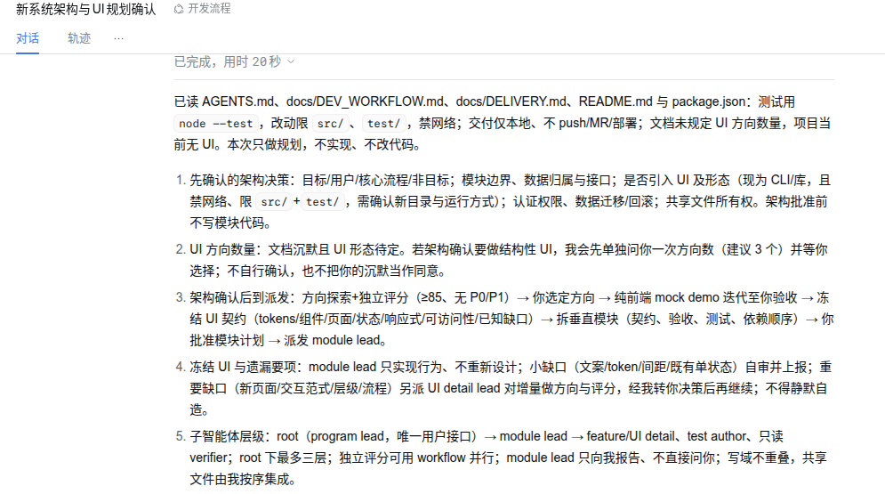

# dsh-dev-workflow

[English](README.md) | [中文](README.zh.md)

A **non-default** agent preset for [DeepSeek Harness](https://github.com/deepseek-ai/deepseek-harness).
Pick **开发流程** (Dev Workflow) for a session and describe what you want
changed; the agent follows a fixed ten-phase delivery pipeline instead of
asking you to paste a long prompt each time.

Installing the bundle only adds the preset. It does **not** change the profile's
default preset, does not add a Host-wide row, and does not affect sessions that
use Standard or another preset.


## What it does

The rules live in a system-prompt section, so they survive context compaction
and do not depend on the conversation history.

| Phase | Result |
|---|---|
| 0. Project understanding | Reads `AGENTS.md`, `docs/DEV_WORKFLOW.md`, `docs/DELIVERY.md`, `README.md`, and other docs; finds commands, delivery, layout, and where UI surfaces live |
| 1. Requirement, contract, triage | Confirms goal, scope, non-goals; classifies the change as **UI design**, **UI behavior**, or **No UI**; writes only the contract fields the triage needs |
| 2. UI exploration | **UI design only:** three structurally different directions with real desktop and mobile screenshots (small changes may use fewer) |
| 3. Independent UI score | **UI design only:** a separate child agent scores each direction out of 100 against the project rubric or the bundled generic rubric; gate is >= 85 with no P0/P1 and no mobile overflow |
| 4. User confirmation | Direction, screenshots, strengths/costs for UI design; changed states for UI behavior; functional change list for No UI |
| 5. Development | One feature agent owns the change and, for UI work, both UI and behavior; a separate test author writes tests only |
| 6. Independent testing | Functional/CLI/API for No UI; changed UI states for UI behavior; viewport/visual/accessibility for UI design; real API/mutations and marker-based cleanup in all cases |
| 7. Independent verification | Read-only verifier checks diff scope, runs the official tests, checks real data/permissions/edge cases and fixture residue; UI score only for UI design; PASS/REJECT |
| 8. User preview | Preview steps/test data/checklist; for No UI a command, sample request, or output sample; internal PASS is not user acceptance |
| 9. Delivery | Follows the project's documented delivery exactly; no assumed MR/PR/CI/deploy |

### Large projects: Program mode

For a new system, a multi-module product, or an architecture/IA redesign, the
lead becomes a program orchestrator instead of implementing everything itself:

1. **Architecture first.** Clarify users, core flows, modules, boundaries,
   interfaces, data ownership, non-goals, and open decisions. Do not write
   module code yet; get architecture approval.
2. **UI direction selection.** Follow the project's UI policy. If it sets a
   direction count, satisfy it; if not, ask for a large/structural UI change
   (recommend three) and wait for the user's choice. Never self-confirm.
3. **Static frontend demo.** Build a pure frontend demo with mock data, iterate
   with user feedback, then freeze tokens, components, screens, states, and
   responsive rules.
4. **Module plan.** Split into complete vertical modules with interfaces,
   owned paths, shared-file rules, dependencies, acceptance criteria, and tests.
5. **Module agents.** Dispatch module leads through `subagent`; each runs this
   pipeline in its module. Frozen UI is not redesigned; a material missing UI
   detail spawns a child UI design/scoring flow. A module lead may spawn its own
   UI, feature, test, and verifier children (depth up to 3 below the root).
6. **Integration.** A read-only integration verifier checks cross-module
   contracts, shared files, migrations, permissions, and fixture residue; then
   user preview and project-documented delivery.

The program lead is the only user interface; module leads report evidence back
to it. Shared files have one owner and change sequentially; independent modules
may run in parallel. See the `dev-workflow-program` skill for the full playbook.



### UI impact is decided per change

Phase 1 classifies the change, not the project:

- **UI design** - new or materially changed hierarchy, layout, interaction
  pattern, or UI surface. Runs Phases 2-3 and the independent UI score.
- **UI behavior** - user-visible behavior, copy, or state change without a new
  design direction. Skips Phases 2-3; keeps UI functional checks and preview,
  but no design score.
- **No UI** - library, CLI, backend, infrastructure, data, build, or docs work.
  Skips all UI phases and the UI score; tests are functional/CLI/API only.

A project that is CLI-only today can get **UI design** when the change adds a
GUI; an existing UI project can get **No UI** for a backend-only change. The
triage is stated in the Phase 1 contract and can be revisited if a new surface
appears.


Project documents are treated as natural language. If the project does not
document delivery, changes stay local and the agent asks **once** how to deliver.
Credentials never go into project files. Remote or destructive commands need
explicit confirmation immediately before they run.

## Install

### From GitHub

The npm name `dsh-dev-workflow` is already used by an unrelated package. **Do
not install this plugin from npm**; install this repository instead.

```text
plugin_manager action=install_bundle target=git+https://github.com/DennisZhangOiler/dsh-dev-workflow.git
```

For a reproducible release, pin the full commit SHA:

```text
plugin_manager action=install_bundle target=git+https://github.com/DennisZhangOiler/dsh-dev-workflow.git#<full-40-hex-commit>
```

Then open a new session, open the preset menu, and choose **开发流程** (Dev
Workflow). Installing the bundle changes no default preset and affects no other
session.

If `plugin_manager` reports a `github.com` connection timeout, use the CLI Git
install below (it has no 5-second probe), or install a release tarball. The
current release is `v0.3.0`; the CLI command was verified on this repo. A
preset update may also report `restart-required`.

### Before installing

Back up the profile so the change is reversible:

```sh
PROFILE_DIR="$DSH_HOME/profiles/<profile>"
cp -a "$PROFILE_DIR" "$PROFILE_DIR.backup-$(date +%Y%m%d-%H%M%S)"
```

### From the DSH Web UI

1. Open **Plugins**.
2. Choose **Add plugin** and select a local `dsh-dev-workflow` checkout; for the
   GitHub source use the `plugin_manager` command above instead.
3. Keep the bundle enabled. It adds the preset only; it does not select it.
4. Open a new session, open the preset menu, choose **开发流程**.

### With the `plugin_manager` agent tool

```text
plugin_manager action=install_bundle target=/absolute/path/to/dsh-dev-workflow
# or a packed release tarball:
plugin_manager action=install_bundle target=/absolute/path/to/dsh-dev-workflow-0.3.0.tgz
```

The target is the bundle directory containing `package.json` and
`cordis.patch.yml`, or a packed release tarball. Installing runs package
management and bundle selection; no manual profile edit is needed. Installing
bundle code requires Full access or approval in DSH. A preset change can
report `restart-required`; restart DSH once, then open a new session.

### Command-line alternative

If you manage the profile from a terminal, the CLI uses the same package
selection and patch validation and takes effect on the next start:

```sh
# GitHub source
dsh plugin --profile <profile> add git+https://github.com/DennisZhangOiler/dsh-dev-workflow.git
# or a local checkout
dsh plugin --profile <profile> add /absolute/path/to/dsh-dev-workflow
# after a restart, verify below; to remove:
dsh plugin --profile <profile> remove dsh-dev-workflow
```

### Verify the preset

```sh
dsh --profile <profile> --dump-config | grep -A3 preset-dev-workflow
dsh --profile <profile> --dump-config | grep -A2 agent-preset-registry
```

The second command should still show the original default (for example
`default: standard`). A new session's preset roster should list **开发流程** (Dev Workflow).

## Use

Start a session with the preset and describe the change:

```text
The settings page still uses an old table. Make it a filterable card list,
keep the existing design system, and make it work on mobile.
```

The preset's contract section then runs the pipeline. You can also trigger the
playbook skills by name: `dev-workflow`, `dev-workflow-project-docs`,
`dev-workflow-ui-rubric`, and `dev-workflow-roles`.

### Recommended project documents

The preset works without any of them, but projects get better results with:

- `AGENTS.md` - commands, boundaries, allowed paths, style rules.
- `docs/DEV_WORKFLOW.md` - how changes are developed and reviewed.
- `docs/DELIVERY.md` - how a change reaches users (branch, MR/PR, CI, deploy,
  manual release, patch only).
- `README.md` - setup and common commands.

Examples are in the `dev-workflow-project-docs` skill and in
[`docs/project-conventions.md`](docs/project-conventions.md). They are examples,
not a required schema.

## Verified

Boot, preset visibility, system-prompt injection, subagent/workflow calls, an
unaffected Standard session, and uninstall residue were checked in a disposable
profile on DSH `0.2.2-rc.5`. Details, evidence, and unverified items are in
[`docs/VERIFICATION.md`](docs/VERIFICATION.md).

## Requirements and compatibility

- DSH `>=0.2.2-rc.5 <0.3.0` (declared in `engines.dsh`).
- Node.js 22 or newer (DSH requirement).
- The profile must provide the Host services this preset mounts: system prompt,
  skills, tools, plan mode, subagents, and workflows. The shipped Web profile
  does. Headless/SDK/ACP profiles do not load the Web preset registry and are
  not supported by this bundle.
- No credentials, network service, or database is added by this plugin.

## What it does not do

- It does not make **开发流程** the default.
- DSH 0.2.2-rc.5 translates only shipped presets (`presetDisplayText`);
  user-authored preset metadata is static. This bundle declares Chinese roster
  copy (**开发流程**) to match a zh-CN system. The bundle card and detail page
  are localized through `locale/*.json`. For an English roster, replace the
  two strings in `cordis.patch.yml` before installing; changing DSH's UI
  language alone does not retranslate them.
- It does not enforce role isolation at the sandbox level; the roles and write
  scopes are enforced by prompts and by the parent's review. If a future DSH
  release adds per-child tool restrictions, wire them in.
- It does not install project skills, a design system, a browser, or a test
  framework. It uses what the project and the session already have.
- It does not promise a central plugin-market listing. See
  [`docs/PUBLISHING.md`](docs/PUBLISHING.md) for the current index format.

## Development

```sh
npm test          # plugin, prompt, and skill contract tests
npm run check     # packaging, manifest, locale, detail, and patch checks
npm run test:smoke # disposable profile: install tarball, check preset, remove
```

`test:smoke` needs `dsh` and `pnpm` on `PATH`; set `DSH_BIN` when the CLI is
somewhere else. It creates a temporary `DSH_HOME`, uses no credentials, and
cleans up after itself.

No dependencies are installed for these checks. `node --test` and Node 22 are
enough. YAML validation in `npm run check` uses `python3` + PyYAML when
available and reports when it is skipped.

Layout:

```text
index.js                 Host-side preset plugin: prompt section + skills
prompt.md                Source of the system-prompt section
cordis.patch.yml         @deepseek-ai/dsh-agent-preset declaration
skills/                  On-demand playbooks loaded through the skill tool
locale/en.json|zh.json   Bundle card metadata
docs/DETAIL*.md          Bundle detail document (one preview image)
docs/preview.svg         Feature image
icon.svg                 Plugin icon
test/                    Unit, packaging, and disposable-profile smoke tests
```

## Uninstall

In **Plugins**, remove the **dsh-dev-workflow** bundle, or:

```text
plugin_manager action=remove_bundle target=dsh-dev-workflow
```

Removing the bundle removes the preset and its prompt section. Sessions already
running keep the preset composition they started with until they are replaced.
No project files are modified by install or removal.

## License

MIT. See [LICENSE](LICENSE).
