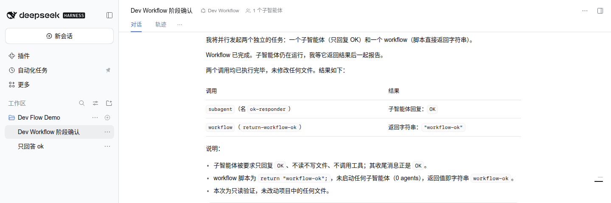

# dsh-dev-workflow

[English](README.md) | [中文](README.zh.md)

A **non-default** agent preset for [DeepSeek Harness](https://github.com/deepseek-ai/deepseek-harness).
Pick **Dev Workflow** for a session and describe what you want changed; the
agent follows a fixed ten-phase delivery pipeline instead of asking you to
paste a long prompt each time.

Installing the bundle only adds the preset. It does **not** change the profile's
default preset, does not add a Host-wide row, and does not affect sessions that
use Standard or another preset.


## What it does

The rules live in a system-prompt section, so they survive context compaction
and do not depend on the conversation history.

| Phase | Result |
|---|---|
| 0. Project understanding | Reads `AGENTS.md`, `docs/DEV_WORKFLOW.md`, `docs/DELIVERY.md`, `README.md`, and other docs; finds commands, delivery, layout, and whether a UI exists |
| 1. Requirement and contract | Confirms goal, scope, non-goals, UI states, viewports, data/API/schema impact, tests, risks, rollback |
| 2. UI exploration | Three structurally different directions with real desktop and mobile screenshots (small changes may use fewer) |
| 3. Independent UI score | A separate child agent scores each direction out of 100 against the project rubric or the bundled generic rubric; gate is >= 85 with no P0/P1 and no mobile overflow |
| 4. User confirmation | Recommended direction, screenshots, strengths/costs, merged change list, explicit non-goals |
| 5. Development | One feature agent owns UI and behavior; a separate test author writes tests only |
| 6. Independent testing | Happy path, negative/permission cases, states, mobile, large data, real API/mutations, marker-based cleanup |
| 7. Independent verification | Read-only verifier checks diff scope, runs the official tests, re-scores the UI, checks fixture residue; PASS/REJECT |
| 8. User preview | Preview steps, test data, acceptance checklist; internal PASS is not user acceptance |
| 9. Delivery | Follows the project's documented delivery exactly; no assumed MR/PR/CI/deploy |



Project documents are treated as natural language. If the project does not
document delivery, changes stay local and the agent asks **once** how to deliver.
Credentials never go into project files. Remote or destructive commands need
explicit confirmation immediately before they run.

## Install

### Before installing

Back up the profile so the change is reversible:

```sh
PROFILE_DIR="$DSH_HOME/profiles/<profile>"
cp -a "$PROFILE_DIR" "$PROFILE_DIR.backup-$(date +%Y%m%d-%H%M%S)"
```

### From the DSH Web UI

1. Open **Plugins**.
2. Choose **Add plugin** and select the `dsh-dev-workflow` directory (or install
   the published npm package when one exists).
3. Keep the bundle enabled. It adds the preset only; it does not select it.
4. Open a new session, open the preset menu, choose **Dev Workflow**.

### With the `plugin_manager` agent tool

```text
plugin_manager action=install_bundle target=/absolute/path/to/dsh-dev-workflow
```

The target is the bundle directory containing `package.json` and
`cordis.patch.yml`. Installing runs package management and bundle selection;
no manual profile edit is needed. Installing bundle code requires Full access
or approval in DSH.

### Command-line alternative

If you manage the profile from a terminal, the CLI uses the same package
selection and patch validation and takes effect on the next start:

```sh
dsh plugin --profile <profile> add /absolute/path/to/dsh-dev-workflow
# after a restart, verify below; to remove:
dsh plugin --profile <profile> remove dsh-dev-workflow
```

### Verify the preset

```sh
dsh --profile <profile> --dump-config | grep -A3 preset-dev-workflow
dsh --profile <profile> --dump-config | grep -A2 agent-preset-registry
```

The second command should still show the original default (for example
`default: standard`). A new session's preset roster should list **Dev Workflow**.

## Use

Start a session with the preset and describe the change:

```text
The settings page still uses an old table. Make it a filterable card list,
keep the existing design system, and make it work on mobile.
```

The preset's contract section then runs the pipeline. You can also trigger the
playbook skills by name: `dev-workflow`, `dev-workflow-project-docs`,
`dev-workflow-ui-rubric`, and `dev-workflow-roles`.

### Recommended project documents

The preset works without any of them, but projects get better results with:

- `AGENTS.md` - commands, boundaries, allowed paths, style rules.
- `docs/DEV_WORKFLOW.md` - how changes are developed and reviewed.
- `docs/DELIVERY.md` - how a change reaches users (branch, MR/PR, CI, deploy,
  manual release, patch only).
- `README.md` - setup and common commands.

Examples are in the `dev-workflow-project-docs` skill and in
[`docs/project-conventions.md`](docs/project-conventions.md). They are examples,
not a required schema.

## Verified

Boot, preset visibility, system-prompt injection, subagent/workflow calls, an
unaffected Standard session, and uninstall residue were checked in a disposable
profile on DSH `0.2.2-rc.5`. Details, evidence, and unverified items are in
[`docs/VERIFICATION.md`](docs/VERIFICATION.md).

## Requirements and compatibility

- DSH `>=0.2.2-rc.5 <0.3.0` (declared in `engines.dsh`).
- Node.js 22 or newer (DSH requirement).
- The profile must provide the Host services this preset mounts: system prompt,
  skills, tools, plan mode, subagents, and workflows. The shipped Web profile
  does. Headless/SDK/ACP profiles do not load the Web preset registry and are
  not supported by this bundle.
- No credentials, network service, or database is added by this plugin.

## What it does not do

- It does not make **Dev Workflow** the default.
- The preset roster description is a single declaration string and is not
  localized; the bundle card and detail page are localized.
- It does not enforce role isolation at the sandbox level; the roles and write
  scopes are enforced by prompts and by the parent's review. If a future DSH
  release adds per-child tool restrictions, wire them in.
- It does not install project skills, a design system, a browser, or a test
  framework. It uses what the project and the session already have.
- It does not promise a central plugin-market listing. See
  [`docs/PUBLISHING.md`](docs/PUBLISHING.md) for the current index format.

## Development

```sh
npm test          # plugin, prompt, and skill contract tests
npm run check     # packaging, manifest, locale, detail, and patch checks
```

No dependencies are installed for these checks. `node --test` and Node 22 are
enough. YAML validation in `npm run check` uses `python3` + PyYAML when
available and reports when it is skipped.

Layout:

```text
index.js                 Host-side preset plugin: prompt section + skills
prompt.md                Source of the system-prompt section
cordis.patch.yml         @deepseek-ai/dsh-agent-preset declaration
skills/                  On-demand playbooks loaded through the skill tool
locale/en.json|zh.json   Bundle card metadata
docs/DETAIL*.md          Bundle detail document (one preview image)
docs/preview.svg         Feature image
icon.svg                 Plugin icon
test/                    Unit and packaging checks
```

## Uninstall

In **Plugins**, remove the **dsh-dev-workflow** bundle, or:

```text
plugin_manager action=remove_bundle target=dsh-dev-workflow
```

Removing the bundle removes the preset and its prompt section. Sessions already
running keep the preset composition they started with until they are replaced.
No project files are modified by install or removal.

## License

MIT. See [LICENSE](LICENSE).
