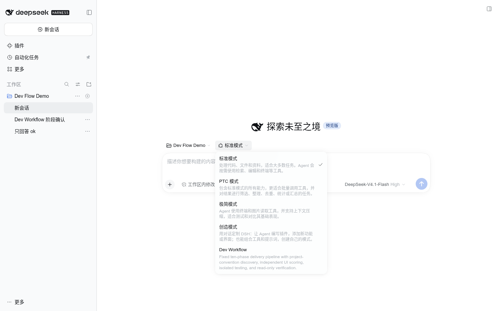
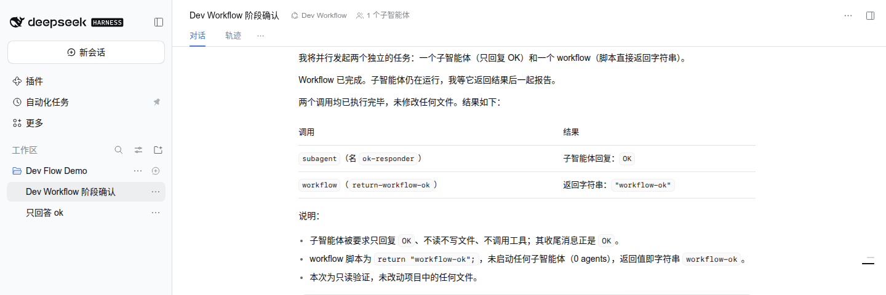

# dsh-dev-workflow

[English](README.md) | [中文](README.zh.md)

一个**非默认**的 [DeepSeek Harness](https://github.com/deepseek-ai/deepseek-harness)
智能体预设。为新会话选择 **Dev Workflow** 后，只需要描述“哪里不满意、要改成
什么、期望效果”，Agent 会按固定的十阶段交付流程推进，不需要每次粘贴长 Prompt。

安装这个 bundle 只新增预设：**不会**修改 profile 的默认预设，不会注册
Host 级的全局行，也不会影响使用 Standard 或其他预设的会话。



## 它做什么

流程规则写在 system prompt section 中，因此不依赖聊天历史，也不会在上下文压缩后
丢失。

| 阶段 | 结果 |
|---|---|
| 0. 项目理解 | 按顺序读 `AGENTS.md`、`docs/DEV_WORKFLOW.md`、`docs/DELIVERY.md`、`README.md` 及其他文档；确认命令、交付方式、目录结构和是否有 UI |
| 1. 需求与契约 | 确认问题、目标、范围、非目标、UI 状态、视口、数据/API/schema 影响、测试范围、风险与回滚 |
| 2. UI 方向探索 | 三套结构不同的方向，每套有真实桌面和移动截图（小改动可减少方向） |
| 3. 独立 UI 评分 | 由独立子智能体按项目 rubric 或内置通用 rubric 百分制评分；门禁为 >=85、无 P0/P1、移动端无横向溢出 |
| 4. 用户确认 | 推荐方向及理由、各方向截图与代价、合并修改清单、明确不做什么 |
| 5. 开发 | 同一功能智能体负责 UI 和功能；测试智能体只写测试 |
| 6. 独立测试 | 正向、负向/权限、状态、移动端、大数据、真实 API/mutation、带 marker 的夹具清理 |
| 7. 独立验收 | 只读 verifier 检查 diff 越界、跑官方测试、独立重评 UI、检查夹具残留；输出 PASS/REJECT |
| 8. 用户预览验收 | 给出预览方式、测试数据、操作步骤、验收清单；内部 PASS 不等于用户验收 |
| 9. 交付 | 严格按项目文档执行；不假设一定有 MR/PR/CI/自动部署 |



项目文档按自然语言处理。如果项目没有写交付方式，改动默认只保留在本地，并且
只问用户一次希望如何交付。凭据不会写入项目文档。远程或破坏性操作执行前必须
获得用户确认。

## 安装

### 安装前备份

先备份 profile，保证可回滚：

```sh
PROFILE_DIR="$DSH_HOME/profiles/<profile>"
cp -a "$PROFILE_DIR" "$PROFILE_DIR.backup-$(date +%Y%m%d-%H%M%S)"
```

### 通过 DSH Web UI

1. 打开 **Plugins**。
2. 选择 **Add plugin**，选中 `dsh-dev-workflow` 目录（如果之后发布了 npm
   包，也可以安装对应包）。
3. 保持 bundle 启用。它只新增预设，不会自动选中。
4. 新建会话，打开预设菜单，选择 **Dev Workflow**。

### 通过 `plugin_manager` 工具

```text
plugin_manager action=install_bundle target=/绝对路径/dsh-dev-workflow
```

target 是包含 `package.json` 和 `cordis.patch.yml` 的 bundle 目录。安装会执行
包管理和 bundle 选择，不需要手工改 profile。安装 bundle 代码需要 Full access
或审批。

### 命令行替代方式

如果从终端管理 profile，CLI 使用同样的包选择和 patch 校验，重启后生效：

```sh
dsh plugin --profile <profile> add /绝对路径/dsh-dev-workflow
# 重启后按下面步骤验证；卸载：
dsh plugin --profile <profile> remove dsh-dev-workflow
```

### 验证预设

```sh
dsh --profile <profile> --dump-config | grep -A3 preset-dev-workflow
dsh --profile <profile> --dump-config | grep -A2 agent-preset-registry
```

第二条应仍显示原来的默认值（例如 `default: standard`）。新会话的预设列表中
应能看到 **Dev Workflow**。

## 使用

选择该预设后直接描述需求：

```text
设置页还是旧表格。改成可筛选的卡片列表，沿用现有设计系统，移动端也要能用。
```

之后由预设的契约 section 驱动完整流程。也可以按名称加载配套 skill：
`dev-workflow`、`dev-workflow-project-docs`、`dev-workflow-ui-rubric`、
`dev-workflow-roles`。

### 建议的项目文档

没有这些文档也能用，但有的话效果更好：

- `AGENTS.md`：命令、边界、允许修改的路径、风格规则。
- `docs/DEV_WORKFLOW.md`：开发、评审、测试流程。
- `docs/DELIVERY.md`：改动如何到达用户（分支、MR/PR、CI、部署、手动发布、
  仅补丁）。
- `README.md`：安装和常用命令。

示例见 `dev-workflow-project-docs` skill 和
[`docs/project-conventions.md`](docs/project-conventions.md)。示例不是固定
字段 schema。

## 已验证

在 DSH `0.2.2-rc.5` 的临时 profile 中验证了：启动、预设可见、system prompt 注入、subagent/workflow 调用、标准会话不受影响、卸载无残留。详细证据和未验证项见
[`docs/VERIFICATION.md`](docs/VERIFICATION.md)。

## 要求与兼容性

- DSH `>=0.2.2-rc.5 <0.3.0`（见 `engines.dsh`）。
- Node.js 22 或更高（DSH 要求）。
- profile 需要提供该预设挂载的 Host 服务：system prompt、skills、tools、
  plan mode、subagent、workflow。官方 Web profile 满足；headless/SDK/ACP
  profile 不加载 Web preset registry，不支持此 bundle。
- 本插件不新增凭据、网络服务或数据库。

## 它不做什么

- 不会把 **Dev Workflow** 设为默认预设。
- 预设菜单里的描述来自声明中的单个字符串，不做本地化；bundle 卡片和详情页是本地化的。
- 不做 sandbox 级的角色隔离；角色和写作用域由 prompt 与父 Agent 的检查保证。
  如果未来的 DSH 版本提供子智能体工具限制，应接入。
- 不安装项目 skill、设计系统、浏览器或测试框架；使用项目和会话已有的能力。
- 不承诺插件市场中心化上架。当前索引格式见
  [`docs/PUBLISHING.md`](docs/PUBLISHING.md)。

## 开发

```sh
npm test          # 插件、prompt、skill 契约测试
npm run check     # 包清单、locale、详情页、patch 检查
```

这些检查不需要安装依赖，Node 22 即可。`npm run check` 在环境有
`python3` + PyYAML 时会校验 YAML，否则会说明跳过。

```text
index.js                 Host 侧预设插件：注册 prompt section + skills
prompt.md                system prompt section 源文
cordis.patch.yml         @deepseek-ai/dsh-agent-preset 声明
skills/                  通过 skill 工具按需加载的 playbook
locale/en.json|zh.json   bundle 卡片元数据
docs/DETAIL*.md          bundle 详情文档（一张预览图）
docs/preview.svg         详情页配图
icon.svg                 插件图标
test/                    单元与打包检查
```

## 卸载

在 **Plugins** 中移除 **dsh-dev-workflow** bundle，或：

```text
plugin_manager action=remove_bundle target=dsh-dev-workflow
```

移除后预设和 prompt section 一并消失。已经在运行的会话会保留启动时的预设
组合，直到被替换。安装和卸载都不会修改项目文件。

## 许可证

MIT，见 [LICENSE](LICENSE)。
