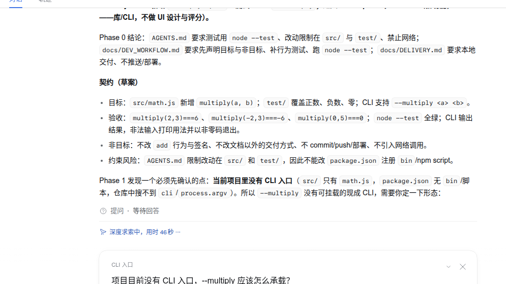
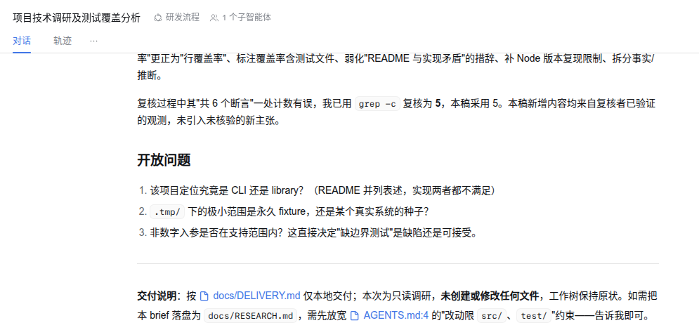

# Verification: R&D Workflow 0.5.0

This file records the checks run for the `dsh-rd-workflow` 0.5.0 release. It is
not a guarantee that a future project's commands are the same; the plugin reads
each project's own conventions at runtime.

## 1. Static checks

Run from the repository root:

```sh
npm test
npm run check
DSH_BIN=<dsh-bin> npm run test:smoke
```

Results:

- `npm test`: 6 tests, 6 pass.
- `npm run check`: packaging checks passed; `cordis.patch.yml` parses as YAML
  (with the `!!js` tag handled by the validator).
- `npm run test:smoke`: packed the tarball, created a disposable web profile,
  installed it, asserted the `preset-dev-workflow` row with `id: dev-workflow`
  and `default: standard`, removed it, and asserted no dependency, lockfile, or
  `node_modules` residue: PASS.
- `npm pack`: 35 files.

Sizes:

- `prompt.md`: 7,987 characters (limit 8,000).
- `skills/rd-workflow.md`: 7,779.
- `skills/rd-workflow-program.md`: 7,797.
- `skills/rd-workflow-roles.md`: 7,800.
- `skills/rd-workflow-research.md`: 6,809.
- `skills/rd-workflow-project-docs.md`: 6,145.
- `skills/rd-workflow-ui-rubric.md`: 5,022.

The preset keeps `id: dev-workflow` for existing sessions; the package,
repository, display name, plugin row, and skill names use `rd-workflow` /
R&D Workflow / 研发流程.

## 2. Preset menu and display name

The preset menu shows **研发流程** with the R&D description; Standard remains
the default.


## 3. Bugfix, then new feature: re-entry

A disposable project with a known `add(-1, -2)` bug was used.

Turn 1, bugfix: the agent fixed `src/math.js`, added a regression test, ran
`node --test` (3 pass), and reported a local-only delivery under `No UI`.

Turn 2, new feature in the same session: the agent did **not** continue the
bugfix loop or silently implement. It re-entered Phase 0/1, restated the project
rules, wrote a new contract for `multiply(a, b)` and a `--multiply` CLI entry,
and asked which CLI shape to use. It also identified that the project has no
CLI entry and that `AGENTS.md` limits changes to `src/` and `test/`. No new
feature code was written before the decision.



## 4. Technical research mode

A new session asked for a read-only investigation of module structure,
dependencies, and test coverage, with standard depth.

Observed:

- the agent read the project docs and source, checked git state, ran the test
  suite and Node's built-in coverage, and did not edit project files;
- it produced a research brief with evidence, scope, confidence, open
  questions, and a delivery note;
- it spawned a **fresh-context independent reviewer** subagent; the reviewer
  caught claims that needed correction, and the final brief recorded the
  corrections;
- it asked before writing `docs/RESEARCH.md` because the test project's
  `AGENTS.md` limited edits to `src/` and `test/` — it did not override the
  project convention.

Project check after the run: no `multiply`, no `docs/RESEARCH.md`, and no new
source/test files; only the earlier bugfix remained.



## 5. Earlier behavior retained

The 0.4.x evidence for Program mode, UI triage, convention bootstrap, and
recursive module delegation remains in this repository:

- `screenshot-program.png`: architecture, UI choice, static demo, frozen UI,
  module agents, recursive subagents.
- `screenshot-triage.png`: `No UI` vs `UI design`.
- `screenshot-bootstrap.png`: a new session follows project docs instead of
  asking again.
- `screenshot-recursion.png`: root -> module-a -> worker-a.
- `screenshot-session.png`: a R&D Workflow session delegating to a child.

Those screenshots predate the display-name change and may show the old
**开发流程** label; the behavior is unchanged and the 0.5.0 preset is
**研发流程**.

## 6. Current profile install

The packed 0.5.0 tarball was installed in the active `web` profile with
`plugin_manager`. The tool returned `application: restart-required`
(`unmanaged-plugin`), so the running Host must be restarted before new sessions
use the new revision. This is expected for this preset plugin, not an install
failure.

- Profile dependency: `dsh-rd-workflow` 0.5.0.
- Bundle: `dsh-rd-workflow`.
- Preset: `dev-workflow`, display **研发流程**.
- Default preset remains `standard`.
- Existing sessions keep their old composition until restart; new sessions
  after restart use 0.5.0.

## 7. Release

- Version: 0.5.0.
- Repository: `DennisZhangOiler/dsh-rd-workflow` (renamed from
  `dsh-dev-workflow`; the old URL redirects).
- Tag: `v0.5.0`.
