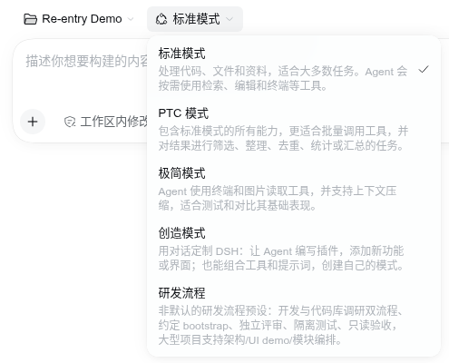
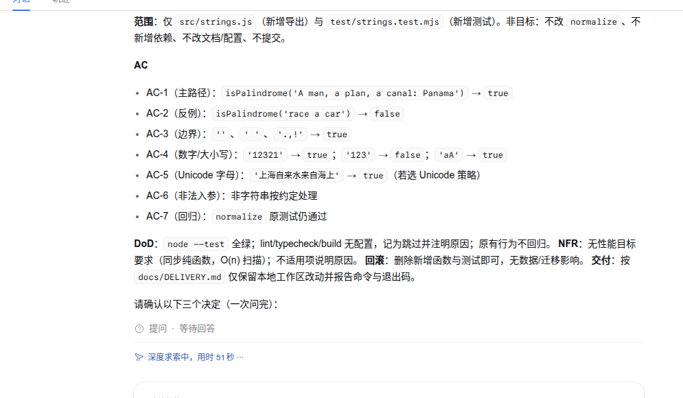

# Verification: R&D Workflow 0.8.0 (historical)

This is the historical verification record for release `v0.8.0`. Current release:
`v0.9.1`; the 0.9.1 change is documentation-only. See `docs/RELEASE-0.9.1.md`.

## 1. Static checks

```sh
npm test
npm run check
DSH_BIN=<dsh-bin> npm run test:smoke
```

Results:

- `npm test`: 12 tests, 12 pass.
- `npm run check`: packaging checks passed; `cordis.patch.yml` parses as YAML
  (with the `!!js` tag handled by the validator).
- `npm run test:smoke`: packed the tarball, created a disposable web profile,
  installed it, asserted the `preset-dev-workflow` row with `id: dev-workflow`
  and `default: standard`, removed it, and asserted no dependency, lockfile, or
  `node_modules` residue: PASS.
- `npm pack`: 42 files (release docs included).

Sizes:

- `prompt.md`: 7,986 characters (limit 8,000).
- `skills/rd-workflow.md`: 7,787.
- `skills/rd-workflow-contract.md`: 6,915.
- `skills/rd-workflow-delivery.md`: 7,776.
- `skills/rd-workflow-program.md`: 7,792.
- `skills/rd-workflow-project-docs.md`: 7,318.
- `skills/rd-workflow-research.md`: 7,786.
- `skills/rd-workflow-research-review.md`: 7,042.
- `skills/rd-workflow-roles.md`: 7,775.
- `skills/rd-workflow-ui-rubric.md`: 6,951.

The preset keeps `id: dev-workflow` for existing sessions; the package,
repository, display name, plugin row, and skill names use `rd-workflow` /
R&D Workflow / 研发流程.

## 2. Preset menu and re-entry

The preset menu shows **研发流程**; Standard remains the default.



A real bugfix→new-feature session re-entered Phase 0/1 and wrote a new contract
instead of continuing the bugfix loop:


## 3. Development E2E: contract → tests → independent verifier → preview → delivery

A disposable ESM project (`src/strings.js`, `test/strings.test.mjs`) was used.
The task was to add `isPalindrome(s)` with no UI and local-only delivery.

Observed:

- Phase 1 produced **AC-1..AC-7** (main, negative, boundary, digits/case,
  Unicode, invalid input, regression), DoD, NFR (no performance target; O(n)),
  risk tier **low**, rollback, and delivery path.
- The user confirmed the AC/DoD/risk/scope; the agent did not implement on
  skipped confirmation. An implementer child and a separate test-author child
  ran; the test author wrote tests only.
- `node --test`: **18/18 pass, exit 0**. The original `normalize` test still
  passes; `src/strings.js` contains only the new export plus the untouched
  baseline.
- A separate read-only verifier (`deepseek-flash`) reported **27/27 checks,
  PASS**, with identity/time.
- The user preview checklist was presented and accepted; the delivery record
  lists changed files, command/exit code, verifier PASS, risk, rollback, and
  evidence hashes.
- `lint`/`typecheck`/`build`/CI were **not configured** in that project; the
  record explicitly marks them skipped with the reason. No deployment/CI
  success was claimed.



A separate 0.8 No-UI fixture pack is recorded in `docs/e2e/0.8/no-ui/`:
contract hash, AC1–AC7 mapping, 8/8 tests, and an independent verifier PASS
**89/100**. It is a disposable fixture, not product acceptance; the earlier
18/18 session above remains the original live run.


The project itself was left with only the intended `src/test` changes; the
candidate did not commit or deploy it.

## 4. Experiment-driven research E2E (0.8, reduced scope)

A disposable ESM project (`hasDuplicateSlow`) was run in headless mode with the
final candidate mounted as a plugin. Artifacts are in
`docs/e2e/0.8/research/`; this is a **reduced E2E**, not a full-plan study and
not an adoption decision.

Observed:

- **R1**: `DECISION.md` and `DIRECTIONS.md` record 14 directions, a do-nothing
  control, top-5 detail, appendix, coverage/feasibility pre-check, and the
  user's approved D0-D4 set.
- **R2**: independent plan reviewer #1 returned **REVISE 86/100** with two P1
  findings (hash-based production provenance/fit control; D1 timed-cell
  full-scan/checksum exemption). The plan was revised; a different reviewer #2
  returned **PASS 90/100**, with per-area floors, reviewer records, input hashes,
  and explicit findings.
- **R3**: a reduced D0 vs D2 run measured n=1000/5000/10000, 3 reps, parity/
  correctness, an always-false mutant control, pre/post production hashes, and
  raw data (`data/raw.json`, `data/env.json`). Production `src/`, `test/`, and
  `package.json` were hash-identical before/after.
- **R5**: a different independent results reviewer wrote `CLAIMS.md` before
  reading any memo, regenerated the inputs, recomputed all medians, and returned
  **PASS 90/100** with supported/partial claims and exact wording. No
  adoption/migration claim exists.
- **R6/R7**: `memo.md` and `HANDOFF.md` limit the result to **candidate/pilot**,
  record what cannot be concluded, and make no production change.

Full-plan cells (D1/D3/D4, memory, scaling, random parity) remain unmeasured and
are explicitly labelled as such; this E2E proves the gate mechanics and evidence
chain, not the full technology decision.


The E2E also includes a memo delta review (`MEMO-REVIEW.md`, PASS) and actual
independent 7/7 calibration outputs (`CALIBRATION-INDEPENDENT-R4.md`): F1 weak
REVISE 5, F2 narrow REVISE 10, F3 single-run REVISE, F4 partial-adopt REVISE,
F5 vague REJECTED, F6 strong PASS 87, F7 intended floor-boundary REVISE 57
(failed floor audit). This is a real blind calibration, not a full-plan
technical decision.

## 5. UI and Program evidence

The 0.4.x evidence for Program, UI triage, convention bootstrap, and recursive
delegation remains in the repository (`screenshot-program.png`,
`screenshot-triage.png`, `screenshot-bootstrap.png`, `screenshot-recursion.png`,
`screenshot-session.png`). Those screenshots predate the display-name change and
may show **开发流程**; the behavior is retained and the 0.8 preset is
**研发流程**.

The 0.8 UI rubric now has per-area floors, anchors, calibration fixtures, real
interaction/mobile/keyboard/a11y checks, and independent scoring even for a
single direction. The 0.8 Program playbook now requires an independent demo
score before freeze, provider/consumer contract tests, runtime-resource
isolation, and gap logging.

A 0.8 UI-design E2E was run for a local release-readiness dashboard: two
directions (Ledger / Instrument), user chose Ledger, and an independent UI
reviewer scored the final page **91/100, PASS**, with **0 P0/P1/P2** and seven
P3s. Evidence: `docs/e2e/0.8/ui/` (`UI-SCORE-R2.md`, desktop/mobile/200%-zoom,
skip-focus and anchor screenshots). User preview acceptance is recorded (`USER-ACCEPTANCE.md`).

A 0.8 Program E2E was run for a two-module readiness service + dashboard
consumer: provider/consumer contract tests, schema/runtime surface, mutation
checks, two child-process isolation, gap log. An independent verifier scored it
**86/100, PASS (narrow)**, 0 P0/P1, five P2. Evidence:
`docs/e2e/0.8/program/` (`PROGRAM-SCORE-R2.md`, `RUNLOG.md`).

## 6. High-risk / migration evidence

A high-risk/migration E2E was run for a 0.7→0.8 preset config migration:
threat model, SCA/license (no deps), targeted SAST, failure cases, real
apply/backup/rollback on temp copies, 7/7 tests, byte-identical rollback, and a
human approval for **rehearsal only**. An independent reviewer scored it
**86/100, PASS (narrow)**, 0 P0/P1. Real profile apply and post-deploy were not
executed and remain blocked. Evidence: `docs/e2e/0.8/high-risk/`.

## 7. Evidence integrity and limitations

- Tests are static registration/packaging checks plus the No-UI development E2E
  and the reduced research E2E above.
- The UI-design E2E (91/100 PASS), Program E2E (86/100 PASS narrow), and
  high-risk/migration rehearsal (86/100 PASS narrow) are recorded above. Real
  profile migration/post-deploy remain blocked and are not claimed.
- Reviewer/verifier independence is prompt/context-based, not sandbox-enforced.
  The E2E verifier records include identity/time; the high-risk gate has a human
  approval for rehearsal only, and real apply still needs separate human review.
- The research E2E now exercises the plan→results review chain at reduced
  scope; the full-plan cells remain unmeasured. UI-design, Program, and
  high-risk/migration rehearsal E2E are verified; real migration is not.
- `v0.8.0` tag and GitHub Release are published; npm is not published.
  The author's Web profile has 0.8.0 installed; a restart may be required for
  the running Host to load it.

## 8. Status at v0.8.0

- Released version: **0.8.0**.
- Active profile: 0.8.0 installed; restart may be required.
- `v0.8.0` tag and GitHub Release are pushed; the release tarball is attached.
- Repository remains `DennisZhangOiler/dsh-rd-workflow`.
- npm: not published; `dsh-rd-workflow` is available.

## 9. Release checklist

1. User confirmed the scope and release.
2. Final functionality/UI review: PASS, 81/100, no P0/P1.
3. Static checks and disposable-profile smoke re-run on the release commit.
4. Tag `v0.8.0`, push `main`, create the GitHub Release, attach the tarball.
5. Update this status to "released".
