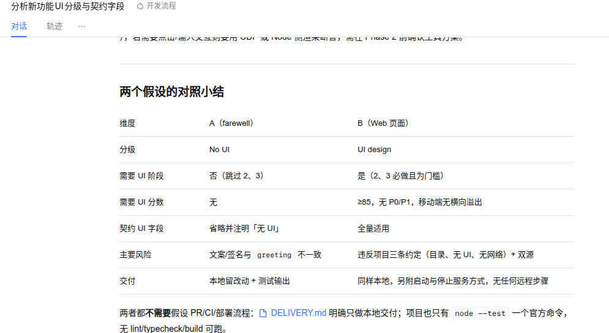

# Disposable-profile verification

Environment: DeepSeek Harness `0.2.2-rc.5`, Node 22, Linux. The test used a
disposable `DSH_HOME` and a profile created from the shipped `web` template;
the real profile was never written.

Paths below use `$TMP_HOME` for the disposable home and `<repo>` for this
checkout. The actual machine paths are intentionally omitted.

## 1. Static

```sh
node --check index.js
npm test
npm run check
```

Result: 6 tests pass, `npm run test:smoke` passes, packaging checks pass, `cordis.patch.yml` parses as YAML
(with `!!js` handled by the validator). `prompt.md` is 7,937 characters; each
skill body is below 8,192 characters. `npm pack --dry-run` lists 28 files and
includes every runtime file, locale, icon, detail document, and skill.

## 2. Install into the disposable profile

```sh
export DSH_HOME="$TMP_HOME"
dsh --profile devflow-test --from-default-profile web --dump-config
dsh plugin --profile devflow-test add <repo>/dsh-dev-workflow
dsh --profile devflow-test --dump-config
```

The CLI routes through `@deepseek-ai/dsh-plugin-manager/operations`
(`runProfilePnpm` + `reconcile`), so it checks compatibility, loads the patch,
and selects the bundle exactly like the manager's package step. The packed
tarball was installed the same way and the preset appeared again, which also
proves the `files` list carries every runtime file (`prompt.md`, `skills/`). The dump then
contained:

```yaml
- id: preset-dev-workflow
  name: '@deepseek-ai/dsh-agent-preset'
  config:
    id: dev-workflow
    name: 开发流程
    order: 5
```

and the preset registry still read:

```yaml
- id: agent-preset-registry
  config:
    default: standard
```

## 3. Boot and preset visibility

`dsh --profile devflow-test --port 3091 --no-open` printed a URL and served the
GUI. The new-session screen showed the preset menu with **Standard** selected
and **开发流程 (Dev Workflow)** listed last. See
[`screenshot-preset.png`](screenshot-preset.png).

The page loaded with no console errors, no horizontal overflow, and no failed
images. The screenshot tool's only warning was low contrast on built-in preset
description text, which is part of DSH's existing menu, not this bundle.

Selecting **开发流程** changed the composer seat label; a fresh session
afterwards still showed **Standard** as the default. See
[`screenshot-preset.png`](screenshot-preset.png) and
the new-session screenshot captured during the test.

## 3a. UI triage by change

A real Dev Workflow session on a CLI-only test project asked for two hypothetical
changes: (A) add a `farewell` function and test; (B) add a local Web page to the
same CLI project. Both were analysis-only.

The model classified A as `No UI` and B as `UI design`, skipped Phases 2-3 and
the UI score for A, and required Phases 2-3, the >=85 gate, no P0/P1, and mobile
overflow checks for B. It also kept local-only delivery from the project docs.



Session evidence: system prompt 13,405 characters, containing the 7,937-character
contract; tool calls read the project docs and loaded the `dev-workflow` skill.
This validates the per-change triage on a project that has no UI today but could
gain one later.

## 3b. Language

DSH `0.2.2-rc.5`'s `presetDisplayText` translates only shipped presets;
user-authored preset metadata is static. This bundle declares Chinese roster
copy (**开发流程**) to match the `zh_CN` system; the bundle card and detail page
localize through `locale/*.json`. Changing the DSH UI language alone does not
retranslate the roster metadata; an English deployment must replace the two
strings in `cordis.patch.yml` before installing. This is a platform limitation,
not a missing locale file.

## 4. Prompt injection

The 开发流程 session's log recorded:

```json
{"type":"agent-preset/selected","data":{"agentPreset":"dev-workflow"}}
```

Its first system message was 13,405 characters and contained `prompt.md`
verbatim (the contract is 7,937 characters):

```json
{"type":"system/message","data":{"message":{"role":"system","content":[{"text":"You are an AI agent powered by DeepSeek Harness.\n\nYou are a coding agent powered by the deepseek-flash model.\n\n## Dev Workflow\n\nThis preset runs a fixed delivery pipeline. ..."}]}}}
```

The model then loaded `dev-workflow` and `dev-workflow-project-docs` through
the `skill` tool, read `AGENTS.md`, `docs/DEV_WORKFLOW.md`, `docs/DELIVERY.md`,
`README.md`, and `package.json`, and answered in Chinese:

- test command: `node --test`
- delivery: local only, no push/MR/deploy
- UI phases: not applicable because the project has no UI
- phase: Phase 0
- skills loaded: `dev-workflow`, `dev-workflow-project-docs`

This is the prompt-injection and project-document evidence; see the session transcript captured during the test; it is not shipped in the bundle.

## 5. Tool availability

The request header for the 开发流程 session listed 24 tools, including
`subagent`, `subagent_fork`, `workflow`, `todo_write`, `ask_user_question`,
`skill`, `read`, `write`, `edit`, `glob`, `grep`, `bash`, `job_*`, `web_*`, and
`present`.

A second turn asked the agent to call both delegation tools. The log shows:

```json
{"type":"tool/call","data":{"name":"subagent","arguments":{"name":"ok-responder","prompt":"..."}}}
{"type":"tool/call","data":{"name":"workflow","arguments":{"script":"return \"workflow-ok\";"}}}
```

Results: the child returned `OK`; the workflow returned `workflow-ok` with
0 agents; the UI showed "1 个子智能体". See
[`screenshot-session.png`](screenshot-session.png).

## 6. Standard session unaffected

A new session without selecting the preset produced `agent-preset/selected`
absent (the default), a 6,147-character system message with no
`## Dev Workflow` section, and a tool list containing the standard
`create_goal`, `plugin_manager`, and `schedule_*` tools instead of this
preset's tool set. It answered `ok` normally.

## 7. Uninstall and residue

```sh
dsh plugin --profile devflow-test remove dsh-dev-workflow
dsh --profile devflow-test --dump-config
```

After removal:

- `package.json` has no `dsh-dev-workflow` dependency.
- `dsh.profile.bundles` is back to `@deepseek-ai/dsh-base` and
  `@deepseek-ai/dsh-web-app`.
- `node_modules/dsh-dev-workflow` is gone.
- `pnpm-lock.yaml` has zero `dsh-dev-workflow` references.
- The composed tree has zero `dev-workflow` references and still reads
  `default: standard`.

The disposable profile's patch gained a `ui-settings-general`
`welcomeNoticeVersion` entry because the test dismissed DSH's welcome dialog.
That is DSH UI state, not bundle residue; no plugin row, preset, or prompt
section remained.

## 8. Real profile untouched

Before the test, the real Web profile files had these hashes and mtimes:

| File | mtime | SHA-256 |
|---|---|---|
| `package.json` | 2026-11-19 17:45 | `cf120153f35f50948472f77cc365e662e3363c7d7e57c58a6d4743fecf0eabd0` |
| `cordis.patch.yml` | 2026-11-19 15:01 | `32f0702ed94996616d825ad4f305562f031661dc444b4c433432e4dee961f128` |
| `cordis.yml` | 2026-11-19 17:47 | `c300dcf2ebc5f02062d6591268d29d3db6fe45e0cb138f5467276fe2ba06076e` |

They were unchanged after the test, and all mtimes predate it. No
`plugin_manager` call was made in the real profile.

## 9. Display metadata

The Plugins page showed the bundle under **已安装插件** as **开发流程（Dev Workflow）** with
the local icon, Chinese description, version `v0.1.0`, and the
`preset-dev-workflow` component running. The detail page rendered the Chinese
`meta.description`, the `preview.svg` image, and the source link. See
The Plugins page and detail page were checked in the disposable GUI; a detail-page screenshot is not shipped because its source link shows a local test path.

## 10. Current profile install

After the disposable test, the user's current `web` profile was changed with
explicit permission and a full profile backup was taken first:

- `@xiaoxie-ide/dsh-devflow` 1.5.1 removed with
  `plugin_manager remove_bundle`; result `application: applied`.
- `dsh-dev-workflow` 0.1.0 installed from the packed tarball with
  `plugin_manager install_bundle`; result `application: applied`.
- `package.json` and `pnpm-lock.yaml` contain no old DevFlow reference.
- The composed tree contains `preset-dev-workflow` with the Chinese roster copy
  and no `preset-devflow`; `agent-preset-registry` still reads
  `default: standard`.
- The old plugin's project data directory (`.devflow/` in the workspace) was
  left untouched because it is user data, not plugin installation residue.

## Not verified

- The Web **Plugins > Add plugin** directory-picker flow was not clicked; the
  agent `plugin_manager` install/remove path was exercised on the current
  profile.
- Visual confirmation in the already-open GUI after live HMR. The current
  profile reported `application: applied`, but the authenticated GUI URL is
  only in the user's browser; the roster was verified in a fresh disposable GUI
  and by the current profile's `--dump-config`.
- `subagent_fork`, plan-mode toggle, `todo_write`, and `ask_user_question` were
  present in the schema but not each exercised end to end.
- Other DSH versions, Windows/macOS, headless/SDK/ACP profiles.
- A full UI design cycle (directions, screenshots, scoring) and a full
  feature change through all ten phases. The prompt, skills, project-document
  reading, no-UI skip, and delegation paths were exercised.
- Central marketplace listing. See `PUBLISHING.md`; DSH has no central upload
  endpoint in this version.
